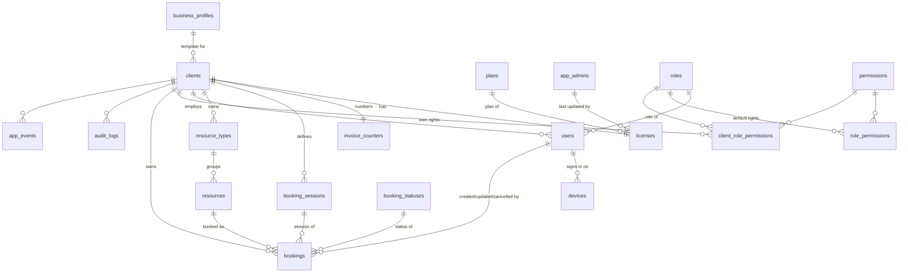

# ArenaBook × Supabase — Backend & Integration Specification

> **Audience:** the coding agent working in the ArenaBook Flutter repository (VS Code).
> **Status:** Final, agreed with the owner (DevCat Studios) on 2026-11-02. Supersedes every earlier backend draft.
> **Companion file:** `PROJECT_SPEC.md` (describes the app as it is today). Where the two disagree about the *backend* or *data*, **this file wins**. Where this file is silent about UI behaviour, `PROJECT_SPEC.md` and the code win.

---

## Contents

0. [How to use this document](#0-how-to-use-this-document)
1. [Product context in one page](#1-product-context-in-one-page)
2. [Decision log (what was decided and why)](#2-decision-log-what-was-decided-and-why)
3. [Target architecture](#3-target-architecture)
4. [Supabase project setup](#4-supabase-project-setup)
5. [Database conventions](#5-database-conventions)
6. [Schema: all 19 tables (DDL)](#6-schema-all-19-tables-ddl)
7. [Seed data](#7-seed-data)
8. [Triggers](#8-triggers)
9. [Security: helpers, RLS, grants](#9-security-helpers-rls-grants)
10. [Read model: the `booking_details` view](#10-read-model-the-booking_details-view)
11. [RPC API (database functions)](#11-rpc-api-database-functions)
12. [Concurrency and integrity guarantees](#12-concurrency-and-integrity-guarantees)
13. [Authentication, session and one-phone-per-user](#13-authentication-session-and-one-phone-per-user)
14. [Roles, permissions and staff management](#14-roles-permissions-and-staff-management)
15. [Licence / trial switch](#15-licence--trial-switch)
16. [Flutter integration](#16-flutter-integration)
17. [Logs and retention](#17-logs-and-retention)
18. [Client onboarding and the future admin panel](#18-client-onboarding-and-the-future-admin-panel)
19. [Operations: cost, storage, backups, security checklist](#19-operations-cost-storage-backups-security-checklist)
20. [Testing plan](#20-testing-plan)
21. [Implementation milestones (with acceptance criteria)](#21-implementation-milestones-with-acceptance-criteria)
22. [Out of scope — do NOT build](#22-out-of-scope--do-not-build)
23. [Open items for the owner](#23-open-items-for-the-owner)
24. [Appendix A: error codes](#appendix-a-error-codes)
25. [Appendix B: Dart constants that mirror lookup ids](#appendix-b-dart-constants-that-mirror-lookup-ids)
26. [Appendix C: glossary](#appendix-c-glossary)

---

## 0. How to use this document

### 0.1 What you are building

A Supabase (Postgres) backend shared by **all** ArenaBook clients, and the Flutter changes that make the app use it:

- Every client business (tenant) lives in the **same** database, isolated by `client_id` and **Row Level Security (RLS)**.
- Each client still gets its **own branded APK** (Flutter flavor). The flavor name is the client's `client_code`.
- **All business configuration moves to the database** (name, address, profile, terms, policy, resources, rates…), so small changes need no new build.
- Bookings are **created and changed online only** (server-confirmed, zero double-booking), and **viewable offline** from a local cache.
- One client can have **many users** (one owner + staff), each with **role-based rights that each client can adjust**.
- Each user can be signed in on **one phone at a time**; signing in elsewhere asks to sign out the old phone.
- Invoices are numbered **per client by the server**: `INV-<client_id>-00001`.
- **Fresh start:** no device has real data. There is **no migration of old Hive data** and no legacy JSON compatibility.

### 0.2 Golden rules (apply everywhere)

1. **Database names are `snake_case`; Dart names are `camelCase`.** Map with `@JsonSerializable(fieldRename: FieldRename.snake)`. Never quote identifiers in SQL; never use PascalCase in the database.
2. **Every table** has: an `integer` identity primary key named `<singular>_id`, `data_status smallint` (`0` = deleted/disabled, `1` = active), and `created_at timestamptz`. Every table that can change also has `updated_at timestamptz` (set by trigger). Only the two log tables are append-only (no `updated_at`).
3. **No hard deletes** of business data. "Delete" = `data_status = 0`. The only physical deletes are log retention jobs (§17).
4. **The phone never writes tables directly.** All writes go through `security definer` RPC functions that check session, permission and licence. Direct `insert/update/delete` is revoked for `anon` and `authenticated`.
5. **The server is the source of truth.** The app validates for good UX (existing pure-Dart `BookingRules`), but the database re-validates everything and enforces the critical rules with constraints.
6. **Never branch on a specific client or client code** in Dart or SQL. Differences between clients are **data** (columns), behaviours selected by `business_profile_id`, or flags (`allow_discount`, `show_entry_pass`).
7. **Never put the service-role / secret key in the app or in git.** The app only ships the project URL and the anon (publishable) key.
8. **Lookup ids are fixed.** The seed inserts them with explicit ids; Dart mirrors them as constants (Appendix B). Do not look lookup rows up by name at runtime.
9. **Keep it lean.** Implement only what this document specifies. Section 22 lists things that must **not** be built now.
10. **Time:** booking day/time are **local wall-clock** (`booking_date` + minutes from that day's midnight). All other timestamps are `timestamptz` (UTC in storage), displayed in the client's `timezone` (`Asia/Karachi`). Never derive a booking's day from UTC.
11. **Clock is injectable** in Dart (existing `clock:` pattern). Rules and controllers never call `DateTime.now()` directly.
12. Keep the existing architecture: **Screens → controllers → `BookingService` (single source of truth, reactive list) → repository interface**. Pure rule modules (`BookingRules`, `BookingStats`, `InvoiceText`) stay pure and unit-tested.

### 0.3 Document conventions

- SQL in this document is the **intended implementation**. Copy it into migrations, then run the tests in §20. If you find a genuine bug, fix it and note the change in the migration comment; do not change behaviour silently.
- "RPC" = a Postgres function in schema `public`, called from Dart via `supabase.rpc('name', params: {...})`.
- Function parameters are prefixed `p_`, local variables `v_` (avoids name clashes with columns).
- **Verification already done:** all SQL in §6–§11 was loaded into PostgreSQL 16 with stand-ins for Supabase's `auth`, `storage` and roles (pg_cron and the Realtime publication were stubbed), and exercised end to end: client onboarding, owner/staff sessions, RLS isolation between two clients, double-booking rejection (incl. touching ranges and cross-midnight), idempotent retries, gapless invoice numbers, policy/step/past/phone validation, event sessions, stale-edit detection, Mark Paid, cancel → Refunded, phone replacement cutting off the old session, owner-editable staff rights, licence block, `get_app_access` JSON, and audit diffs. A **20-way parallel** `create_booking` race on one slot produced exactly 1 success and 19 × `AB020`, with no invoice gaps. Re-run the same checks as pgTAP tests (§20) against real Supabase.

---

## 1. Product context in one page

| | |
|---|---|
| **Product** | ArenaBook: a booking + payment ledger for businesses that rent time on a resource (courts, rooms, halls, vehicles). |
| **Users** | The business owner and their staff, on their own phones. **Customers never use the app.** |
| **Core job** | Book a resource for a time range **without double booking**, record fee / discount / advance / balance, share a receipt (image or text) on WhatsApp. |
| **Distribution** | One white-labelled APK per client, built from one codebase via Flutter flavors. Flavor name = `clients.client_code`. |
| **Market** | Pakistan: currency `Rs`, country code `92`, time zone `Asia/Karachi` (UTC+5, no DST). |
| **Stack** | Flutter 3.38 / Dart 3.10, GetX (state, routing, DI), Hive CE (local cache), SharedPreferences (device prefs), `share_plus`, `qr_flutter`, `url_launcher`. |
| **Business profiles** | `sports_venue`, `space_rental`, `event_venue`, `vehicle_rental`. A profile supplies wording (Terms), default booking policy, pricing mode and features. |
| **Scale** | Tens to hundreds of clients. A busy venue: 30–80 bookings/day (10–30k/year). An event hall: a few hundred/year. Load is tiny; the hard parts are **correctness, multi-user concurrency, isolation and cost**. |

Behaviour that **does not change** (see `PROJECT_SPEC.md` §3 for details): the five tabs (Home, Bookings, +, Pending, Calendar), the booking form (resource type → resource → date → time/sessions → customer → price → discount → advance), Repeat, Edit, Cancel (reason + advance returned/kept), Mark Paid (confirm dialog), invoice sheet with QR entry pass and WhatsApp share, dashboard stats computed from the booking list, light/dark theme, reduce-motion support.

---

## 2. Decision log (what was decided and why)

| # | Topic | Decision | Reason |
|---|---|---|---|
| D1 | Backend | **Supabase** (managed Postgres + Auth + Realtime + Storage). | Relational data, exclusion constraints for double booking, RLS, SQL portability, cheap. One developer; managed services preferred. |
| D2 | Tenancy | **One shared database** per environment, `client_id` on every client-owned row, RLS isolation. **Not** one database per client. | Tiny data per client; one schema to migrate; cross-client admin view; free/cheap. |
| D3 | Environments | Two projects: `arenabook-dev` and `arenabook-prod`, region **Mumbai (ap-south-1)**. | Closest region to Pakistan; dev never touches client data; fits the free plan (2 projects). |
| D4 | Naming | **snake_case** in the database, camelCase in Dart (mapped). | No quoting in SQL ever; Postgres/Supabase convention; Dart needs a mapping anyway. |
| D5 | Keys | `integer` identity PK on **every** table, named `<singular>_id`. Flavor name is **not** a key; it is `clients.client_code` (unique). | Owner's convention; joins fetch names when needed. |
| D6 | Status | `data_status smallint` (`0` deleted/disabled, `1` active) on **every** table, enforced with a `CHECK`, **not** an FK. | Uniform soft-delete; a lookup FK on every table would add joins for no benefit; widen the CHECK later if more values are needed. |
| D7 | Timestamps | `created_at` on every table; `updated_at` on every mutable table (both on `clients`, as separate columns). | Auditing, sync, admin panel. |
| D8 | Lookups | **Lookup table + FK** when the list has attributes, can grow, or should be editable without a migration: `roles`, `permissions`, `role_permissions`, `plans`, `booking_statuses`, `business_profiles`. **CHECK constraint** for small technical flags: `data_status`, `pricing_mode`, resource `tone`, log `level`, device `platform`. **No Postgres ENUM types.** | Flexibility where it matters, simplicity elsewhere. |
| D9 | Writes | **Online-only** create / edit / cancel / mark-paid, via RPC. **Offline = read-only** from cache. | Zero error margin with several staff booking simultaneously; server assigns invoice numbers; removes outbox/conflict complexity. |
| D10 | Double booking | Postgres **exclusion constraint** on `(resource_id, tstzrange(starts_at, ends_at))` for active, non-cancelled bookings. Idempotency via client-generated `request_uid`. Optimistic concurrency on edits via `updated_at`. | Guaranteed by the database under any concurrency. |
| D11 | Invoices | `INV-<client_id>-<number>`, number per client from a locked counter, padded to **5 digits** (`INV-12-00001`, grows past 99999 naturally). | Each invoice identifies its client; 4 digits would overflow in months for busy venues. |
| D12 | Users | Many users per client, **each login belongs to exactly one client**. `users` has `client_id` + `role_id`. | Owner + staff model; simpler than memberships. |
| D13 | Rights | Roles + permissions. **Default template** per role (`role_permissions`), **copied per client** (`client_role_permissions`) and editable by that client's owner. Owner role always has full access and cannot be edited. | Different clients want different staff rights. |
| D14 | Devices | **One active phone per user.** Identified by a random `device_uid` (secure storage) + the Supabase `session_id` from the JWT. Signing in on a new phone asks to replace the old one; the old phone is cut off immediately. MAC address is **not** used (Android 10+/iOS hide it). | Requested by owner; enforceable server-side. |
| D15 | Booking status | `booking_statuses` lookup (Pending, Paid, Cancelled, Refunded) referenced by `bookings.booking_status_id`, **set automatically by a trigger** from the money/cancel fields. "Completed" is **not** stored (derived from time: `ends_at < now()`). | No drift between status and amounts. |
| D16 | Config | **All business configuration moves to the database** now (fresh start). Only identity/launcher/build items stay compiled. | Change a client without a new build. |
| D17 | Licence | `licenses` table replaces the GitHub Gist. Standard columns replace duplicate Gist fields; `get_app_access` returns **the exact same JSON keys** as the Gist so app rules stay the same. | Long-term clean schema, no app logic change. |
| D18 | Logs | `audit_logs` (compact field diffs, by triggers) + `app_events` (warnings/errors only, from the app). Supabase platform logs are separate and free of DB quota. | Bounded storage on the 500 MB free plan. |
| D19 | Admin | Platform admins live in `app_admins`; RLS lets them read all clients (requires MFA, `aal2`). | Future admin/monitoring panel without exposing the service key. |
| D20 | Sign-in | **Email one-time code (6 digits)**, invite-only (public sign-up disabled). Google sign-in deferred. | Free; Google needs per-flavor OAuth setup. |
| D21 | Fresh start | No legacy data, no v1–v3 JSON migrations, no `TRF-` ids, no `sport`/`courtId` keys, no Gist fallback. | Owner confirmed no device has data. |

---

## 3. Target architecture

```
┌──────────────────────────── Client phone (one APK per client) ─────────────────────────────┐
│ Screens (5 tabs, forms, dialogs)                                                            │
│   └─ BookingService (GetxService, reactive list, UI-side validation via BookingRules)       │
│        └─ BookingRepository (interface)                                                     │
│             └─ SupabaseBookingRepository ── RPC writes ──────────────┐                      │
│                  └─ Hive cache (read-only offline)  ◄── refresh/Realtime ──┐                │
│ ClientBundleService (client config, resources, permissions; cached in Hive)│                │
│ SessionService (sign-in, start_session, device replace, sign-out)          │                │
│ AppAccessService (licence check via get_app_access, before sign-in)        │                │
└───────────────────────────────────────────────────────────────────────────│────────────────┘
                                                                            │ HTTPS + WSS
┌──────────────────────────── Supabase project (Mumbai) ────────────────────▼────────────────┐
│ Auth: email OTP (invite-only); JWT carries user id + session_id                            │
│ PostgREST: public RPC functions + read-only table/view access filtered by RLS              │
│ Realtime: postgres_changes on bookings/config tables (RLS-filtered)                        │
│ Postgres: 19 tables, RLS on all, exclusion constraint, triggers (derive, status, audit)    │
│ Storage: public bucket `client-assets` (logos)                                             │
│ Edge Function: `add-staff-user` (creates an auth user with the service key)                │
│ pg_cron: log retention                                                                     │
└────────────────────────────────────────────────────────────────────────────────────────────┘
          ▲
          │ SQL editor / service key / admin panel (MFA)
   Developer (DevCat Studios)
```

### 3.1 Entity relationship diagram



`auth.users` (Supabase-managed) is referenced by `users.auth_user_id` and `app_admins.auth_user_id`.

### 3.2 Table inventory (19)

| Group | Table | Purpose |
|---|---|---|
| Lookups (6) | `roles` | Owner, Staff (more later). `is_full_access` marks owner-like roles. |
| | `permissions` | Every right the app knows (`booking.cancel`, `revenue.view`, …). |
| | `role_permissions` | **Default template** of rights per role. |
| | `plans` | Trial / Monthly / Yearly / Lifetime with price, duration, `max_users`. |
| | `booking_statuses` | Pending, Paid, Cancelled, Refunded. |
| | `business_profiles` | The 4 profiles with default terms, policy, pricing, features, sessions. |
| Client setup (7) | `clients` | One row per business: identity, contact, profile, time zone, currency, terms, **effective** policy, pricing mode, features. |
| | `invoice_counters` | Last invoice number per client (row-locked counter). |
| | `client_role_permissions` | **This client's** rights per role (copied from the template, editable by owner). |
| | `booking_sessions` | Fixed sessions (Lunch / Dinner / Full Day) for session-based clients. |
| | `licenses` | Licence / trial switch per client (replaces the Gist). |
| | `resource_types` | Cricket, Padel, Room, Sedan… with hourly rate. |
| | `resources` | Each court / room / hall / vehicle. |
| People (3) | `app_admins` | Platform admins (DevCat). |
| | `users` | Client users (owner, staff), linked to `auth.users`. |
| | `devices` | Phones users signed in on; one active per user. |
| Ledger (1) | `bookings` | Every booking with money and status. |
| Logs (2) | `audit_logs` | Automatic compact history of changes. |
| | `app_events` | Warnings/errors reported by the app. |

---

## 4. Supabase project setup

### 4.1 Projects

| Project | Purpose | Plan | Region |
|---|---|---|---|
| `arenabook-dev` | Development, demo clients, migration testing | Free | Mumbai (ap-south-1) |
| `arenabook-prod` | Real clients only | Free while piloting → **Pro (~$25/month) once clients pay** | Mumbai (ap-south-1) |

Owner tasks (manual, once): create organization **DevCat Studios**, enable **2FA** on the Supabase account, create both projects, store each database password in a password manager.

### 4.2 Repository layout to create

```
arenabook/
├── lib/                                   # Flutter app
├── config/
│   ├── dev.json                           # SUPABASE_URL, SUPABASE_ANON_KEY, APP_ENV (gitignored)
│   ├── prod.json                          # same for prod (gitignored)
│   └── example.json                       # committed template with placeholder values
├── supabase/
│   ├── config.toml                        # created by `supabase init`
│   ├── migrations/
│   │   ├── 20261103000100_foundation.sql  # extensions, private schema, set_updated_at()
│   │   ├── 20261103000200_lookups.sql     # roles, permissions, role_permissions, plans, booking_statuses, business_profiles
│   │   ├── 20261103000300_clients.sql     # clients, invoice_counters, client_role_permissions, booking_sessions, licenses, resource_types, resources
│   │   ├── 20261103000400_people.sql      # app_admins, users, devices
│   │   ├── 20261103000500_bookings.sql    # bookings + constraints + indexes
│   │   ├── 20261103000600_logs.sql        # audit_logs, app_events
│   │   ├── 20261103000700_helpers.sql     # private.* helper functions
│   │   ├── 20261103000800_triggers.sql    # updated_at, booking derive/guard, audit
│   │   ├── 20261103000900_rls.sql         # RLS policies + grants
│   │   ├── 20261103001000_views.sql       # booking_details
│   │   ├── 20261103001100_rpc_session.sql # get_app_access, start_session, sign_out_device, get_client_bundle
│   │   ├── 20261103001200_rpc_bookings.sql# create/update/mark_paid/cancel booking
│   │   ├── 20261103001300_rpc_settings.sql# rates, currency, staff rights, users, logs
│   │   ├── 20261103001400_rpc_admin.sql   # admin_create_client, admin_add_user
│   │   ├── 20261103001500_seed_lookups.sql# lookup rows (needed in every environment)
│   │   ├── 20261103001600_realtime_storage_cron.sql
│   │   └── 20261103001700_grants.sql      # execute grants on RPC functions (§9.3)
│   ├── seed.sql                           # DEV ONLY: 4 demo clients + demo users
│   ├── functions/
│   │   └── add-staff-user/index.ts        # Edge Function (Deno)
│   └── tests/
│       └── *.test.sql                     # pgTAP tests (see §20)
├── scripts/
│   ├── build.sh / build.bat               # now pass --dart-define-from-file=config/<env>.json
│   └── backup/                            # (optional) helper for nightly dumps
└── .github/workflows/
    ├── nightly-backup.yml
    └── audit-archive.yml
```

> Lookup rows go in a **migration** (not `seed.sql`) because production needs them too. `seed.sql` is only for local/dev demo data.

### 4.3 Local workflow

1. Install Supabase CLI and Docker Desktop.
2. `supabase init` (once), then `supabase start` to run a local stack.
3. Write migrations; run `supabase db reset` (applies migrations + `seed.sql`) and `supabase test db` (pgTAP).
4. Deploy: `supabase link --project-ref <dev-ref>` → `supabase db push`. Prod only after dev passes: `supabase link --project-ref <prod-ref>` → `supabase db push`.
5. Edge Function: `supabase functions deploy add-staff-user --project-ref <ref>`.

### 4.4 Dashboard settings (both projects)

| Area | Setting |
|---|---|
| Authentication → Providers → Email | Enabled. **Email OTP**, length **6**, expiry 600 s. |
| Authentication → Sign In / Up | **Disable "Allow new users to sign up"** (invite-only). |
| Authentication → Email templates | "Magic Link" template body shows the code: `Your ArenaBook code is {{ .Token }}`. |
| Authentication → SMTP | **Custom SMTP** (Resend or Brevo free tier) before the first real client; built-in email is rate-limited. |
| Authentication → Sessions | Defaults (JWT expiry 3600 s, refresh token rotation on). |
| Authentication → MFA | Enable **TOTP** (needed by app admins, `aal2`). |
| API → Exposed schemas | `public` only (keep `private` unexposed). |
| Database → Extensions | `btree_gist`, `pg_cron` (also created by migration). |
| Storage | Bucket `client-assets`, **public** (created by migration). |
| Realtime | Enabled; tables added to the publication by migration. |

### 4.5 Keys and build config

- The app needs only `SUPABASE_URL` and `SUPABASE_ANON_KEY` (the anon / publishable key). Both are safe to ship because RLS and revoked grants make them powerless on their own.
- The **service-role / secret key** lives only in: the Edge Function's environment (provided by Supabase automatically), your local machine for scripts, and GitHub Actions secrets.
- `config/dev.json` / `config/prod.json`:

```json
{
  "APP_ENV": "dev",
  "SUPABASE_URL": "https://<ref>.supabase.co",
  "SUPABASE_ANON_KEY": "<anon-or-publishable-key>"
}
```

- Build: `flutter build apk --flavor <client_code> --dart-define-from-file=config/prod.json`. Update `scripts/build.(sh|bat)` to take `<client_code> <env>`.

---

## 5. Database conventions

| Item | Convention | Example |
|---|---|---|
| Table names | snake_case, plural | `booking_statuses`, `resource_types` |
| Primary key | `<singular>_id integer`, identity | `license_id`, `plan_id`, `booking_id` |
| Identity kind | Lookup tables: `generated by default as identity` (seeded with explicit ids, then sequence reset). All others: `generated always as identity`. | |
| Foreign key | Same name as the referenced PK | `client_id`, `role_id`, `booking_status_id` |
| Soft status | `data_status smallint not null default 1 check (data_status in (0, 1))` | `0` deleted/disabled, `1` active |
| Created | `created_at timestamptz not null default now()` | |
| Updated | `updated_at timestamptz not null default now()` + `set_updated_at` trigger | |
| Booleans | `boolean` is fine for real yes/no flags (`is_full_access`, `allow_discount`) | `data_status` stays int by decision |
| Money | `integer`, whole currency units (no paisa) | `total_fee 10500` |
| Booking time | `booking_date date` + `start_minute` / `end_minute` (minutes from that day's midnight; end may reach 2880) | 22:30–01:30 next day = `1350`–`1530` |
| Codes | Stable machine code columns are `*_code text unique` | `role_code 'owner'`, `permission_code 'booking.cancel'` |
| Functions | `public.*` = callable RPC; `private.*` = internal helpers (not exposed) | |
| Params / vars | `p_` / `v_` prefixes | `p_booking_id`, `v_client` |
| Errors | `raise exception using errcode = 'ABxxx', message = '<user-safe text>'` | Appendix A |

---

## 6. Schema: all 19 tables (DDL)

> Put each block in the migration named in §4.2. Order matters: lookups → clients → people → bookings → logs.

### 6.1 Foundation (`…000100_foundation.sql`)

```sql
create extension if not exists btree_gist with schema extensions;
create extension if not exists pg_cron;

create schema if not exists private;

create or replace function private.set_updated_at()
returns trigger
language plpgsql
set search_path = ''
as $$
begin
  new.updated_at := now();
  return new;
end;
$$;
```

### 6.2 Lookups (`…000200_lookups.sql`)

```sql
create table public.roles (
  role_id         integer generated by default as identity primary key,
  role_code       text not null unique,                 -- 'owner', 'staff'
  name            text not null,
  is_full_access  boolean not null default false,       -- true = all permissions, not editable
  sort_order      smallint not null default 0,
  data_status     smallint not null default 1 check (data_status in (0, 1)),
  created_at      timestamptz not null default now(),
  updated_at      timestamptz not null default now()
);

create table public.permissions (
  permission_id   integer generated by default as identity primary key,
  permission_code text not null unique,                 -- 'booking.cancel'
  name            text not null,                        -- 'Cancel bookings'
  description     text not null default '',
  sort_order      smallint not null default 0,
  data_status     smallint not null default 1 check (data_status in (0, 1)),
  created_at      timestamptz not null default now(),
  updated_at      timestamptz not null default now()
);

create table public.role_permissions (                  -- default template
  role_permission_id integer generated by default as identity primary key,
  role_id         integer not null references public.roles (role_id),
  permission_id   integer not null references public.permissions (permission_id),
  is_allowed      boolean not null,
  data_status     smallint not null default 1 check (data_status in (0, 1)),
  created_at      timestamptz not null default now(),
  updated_at      timestamptz not null default now(),
  unique (role_id, permission_id)
);

create table public.plans (
  plan_id         integer generated by default as identity primary key,
  plan_code       text not null unique,                 -- 'trial', 'monthly', 'yearly', 'lifetime'
  name            text not null,
  duration_days   integer check (duration_days is null or duration_days > 0),  -- null = no expiry
  price           integer not null default 0 check (price >= 0),               -- Rs
  max_users       integer not null check (max_users >= 1),
  sort_order      smallint not null default 0,
  data_status     smallint not null default 1 check (data_status in (0, 1)),
  created_at      timestamptz not null default now(),
  updated_at      timestamptz not null default now()
);

create table public.booking_statuses (
  booking_status_id integer generated by default as identity primary key,
  status_code     text not null unique,                 -- 'pending', 'paid', 'cancelled', 'refunded'
  name            text not null,
  color_key       text not null,                        -- UI token key, e.g. 'warning'
  sort_order      smallint not null default 0,
  data_status     smallint not null default 1 check (data_status in (0, 1)),
  created_at      timestamptz not null default now(),
  updated_at      timestamptz not null default now()
);

create table public.business_profiles (
  business_profile_id      integer generated by default as identity primary key,
  profile_code             text not null unique,        -- 'sports_venue', ...
  name                     text not null,
  default_terms            jsonb not null,              -- Terms strings (see §7.6)
  slot_step_minutes        smallint not null check (slot_step_minutes in (15, 30, 60)),
  min_duration_minutes     smallint not null,
  max_duration_minutes     smallint not null check (max_duration_minutes <= 1440),
  default_duration_minutes smallint not null,
  open_start_minute        smallint,                    -- null = open 24 h
  open_end_minute          smallint,
  offers_full_day          boolean not null default false,
  pricing_mode             smallint not null check (pricing_mode in (1, 2)),  -- 1 hourly, 2 manual
  allow_discount           boolean not null default true,
  show_entry_pass          boolean not null default true,
  default_sessions         jsonb not null default '[]', -- [{label,start_minute,end_minute,sort_order}]
  sort_order               smallint not null default 0,
  data_status              smallint not null default 1 check (data_status in (0, 1)),
  created_at               timestamptz not null default now(),
  updated_at               timestamptz not null default now()
);
```

### 6.3 Client setup (`…000300_clients.sql`)

```sql
create table public.clients (
  client_id                integer generated always as identity primary key,
  client_code              text not null unique check (client_code ~ '^[a-z0-9_]+$'),  -- = Flutter flavor
  name                     text not null,
  tagline                  text,
  address                  text,
  phone                    text,
  logo_path                text,                        -- Storage path in bucket client-assets, e.g. '12/logo.png'
  business_profile_id      integer not null references public.business_profiles (business_profile_id),
  timezone                 text not null default 'Asia/Karachi',
  currency_symbol          text not null default 'Rs',
  country_code             text not null default '92',
  terms                    jsonb not null default '{}', -- effective Terms (profile defaults merged with overrides)
  -- effective booking policy
  slot_step_minutes        smallint not null check (slot_step_minutes in (15, 30, 60)),
  min_duration_minutes     smallint not null check (min_duration_minutes > 0),
  max_duration_minutes     smallint not null check (max_duration_minutes <= 1440),
  default_duration_minutes smallint not null,
  open_start_minute        smallint check (open_start_minute between 0 and 1439),
  open_end_minute          smallint check (open_end_minute between 1 and 2880),   -- may pass midnight
  offers_full_day          boolean not null default false,
  -- pricing and features
  pricing_mode             smallint not null default 1 check (pricing_mode in (1, 2)),
  allow_discount           boolean not null default true,
  show_entry_pass          boolean not null default true,
  data_status              smallint not null default 1 check (data_status in (0, 1)),
  created_at               timestamptz not null default now(),
  updated_at               timestamptz not null default now(),
  check ((open_start_minute is null) = (open_end_minute is null)),
  check (open_end_minute is null or open_end_minute > open_start_minute),
  check (min_duration_minutes <= default_duration_minutes
         and default_duration_minutes <= max_duration_minutes)
);

create table public.invoice_counters (
  invoice_counter_id  integer generated always as identity primary key,
  client_id           integer not null unique references public.clients (client_id),
  last_invoice_number integer not null default 0 check (last_invoice_number >= 0),
  data_status         smallint not null default 1 check (data_status in (0, 1)),
  created_at          timestamptz not null default now(),
  updated_at          timestamptz not null default now()
);

create table public.client_role_permissions (
  client_role_permission_id integer generated always as identity primary key,
  client_id      integer not null references public.clients (client_id),
  role_id        integer not null references public.roles (role_id),
  permission_id  integer not null references public.permissions (permission_id),
  is_allowed     boolean not null,
  data_status    smallint not null default 1 check (data_status in (0, 1)),
  created_at     timestamptz not null default now(),
  updated_at     timestamptz not null default now(),
  unique (client_id, role_id, permission_id)
);

create table public.booking_sessions (
  booking_session_id integer generated always as identity primary key,
  client_id      integer not null references public.clients (client_id),
  label          text not null,                          -- 'Lunch'
  start_minute   smallint not null check (start_minute between 0 and 1439),
  end_minute     smallint not null check (end_minute <= 2880),
  sort_order     smallint not null default 0,
  data_status    smallint not null default 1 check (data_status in (0, 1)),
  created_at     timestamptz not null default now(),
  updated_at     timestamptz not null default now(),
  check (end_minute > start_minute)
);
create index booking_sessions_client on public.booking_sessions (client_id);

create table public.licenses (
  license_id              integer generated always as identity primary key,
  client_id               integer not null unique references public.clients (client_id),
  plan_id                 integer not null references public.plans (plan_id),
  is_app_enable           boolean not null default true,      -- Gist: IsAppEnable
  app_disable_after_date  date,                               -- Gist: AppDisableAfterDate
  max_users               integer not null check (max_users >= 1),
  notes                   text not null default '',
  updated_by_app_admin_id integer,                            -- FK added after app_admins exists (§6.4)
  data_status             smallint not null default 1 check (data_status in (0, 1)),  -- Gist: DataEntryStatus
  created_at              timestamptz not null default now(),                         -- Gist: DataEntryDate
  updated_at              timestamptz not null default now()                          -- Gist: LastUpdateDate
);

create table public.resource_types (
  resource_type_id integer generated always as identity primary key,
  client_id      integer not null references public.clients (client_id),
  name           text not null,                          -- 'Indoor Cricket'
  short_name     text not null,                          -- 'Cricket'
  icon_key       text not null,                          -- mapped to IconData in Dart
  tone           text not null check (tone in ('emerald', 'blue', 'violet', 'orange')),
  hourly_rate    integer check (hourly_rate is null or hourly_rate between 1 and 1000000),  -- null for manual pricing
  emoji          text not null default '',
  sort_order     smallint not null default 0,
  data_status    smallint not null default 1 check (data_status in (0, 1)),  -- 0 = hidden from forms; old bookings still show
  created_at     timestamptz not null default now(),
  updated_at     timestamptz not null default now(),
  unique (client_id, resource_type_id)                   -- target for composite FK
);

create table public.resources (
  resource_id      integer generated always as identity primary key,
  client_id        integer not null references public.clients (client_id),
  resource_type_id integer not null,
  name             text not null,                        -- 'Pitch 1'
  description      text not null default '',
  sort_order       smallint not null default 0,
  data_status      smallint not null default 1 check (data_status in (0, 1)),
  created_at       timestamptz not null default now(),
  updated_at       timestamptz not null default now(),
  foreign key (client_id, resource_type_id) references public.resource_types (client_id, resource_type_id),
  unique (client_id, resource_id)                        -- target for composite FK from bookings
);
create index resources_type on public.resources (resource_type_id);
```

The composite foreign keys make it impossible for a resource (or booking) to point at another client's type (or resource).

### 6.4 People (`…000400_people.sql`)

```sql
create table public.app_admins (
  app_admin_id   integer generated always as identity primary key,
  auth_user_id   uuid not null unique references auth.users (id),
  full_name      text not null,
  email          text not null,
  data_status    smallint not null default 1 check (data_status in (0, 1)),
  created_at     timestamptz not null default now(),
  updated_at     timestamptz not null default now()
);

alter table public.licenses
  add constraint licenses_updated_by_fk
  foreign key (updated_by_app_admin_id) references public.app_admins (app_admin_id);

create table public.users (
  user_id        integer generated always as identity primary key,
  auth_user_id   uuid not null unique references auth.users (id),
  client_id      integer not null references public.clients (client_id),
  role_id        integer not null references public.roles (role_id),
  full_name      text not null,
  email          text not null,
  phone          text not null default '',
  data_status    smallint not null default 1 check (data_status in (0, 1)),  -- 0 = disabled (cannot sign in)
  created_at     timestamptz not null default now(),
  updated_at     timestamptz not null default now()
);
create index users_client on public.users (client_id);

create table public.devices (
  device_id          integer generated always as identity primary key,
  user_id            integer not null references public.users (user_id),
  client_id          integer not null references public.clients (client_id),
  auth_session_id    uuid not null,              -- JWT claim session_id of this phone's login
  device_uid         text not null,              -- random UUID kept in the phone's secure storage
  platform_device_id text not null default '',   -- optional hint: ANDROID_ID / identifierForVendor
  device_name        text not null default '',   -- 'Samsung SM-A546E'
  platform           text not null check (platform in ('android', 'ios')),
  app_version        text not null default '',
  last_seen_at       timestamptz not null default now(),
  data_status        smallint not null default 1 check (data_status in (0, 1)),  -- 1 = the active phone
  created_at         timestamptz not null default now(),
  updated_at         timestamptz not null default now()
);
create unique index devices_one_active_per_user on public.devices (user_id) where data_status = 1;
create index devices_session on public.devices (auth_session_id) where data_status = 1;
```

### 6.5 Bookings (`…000500_bookings.sql`)

```sql
create table public.bookings (
  booking_id           integer generated always as identity primary key,
  client_id            integer not null references public.clients (client_id),
  request_uid          uuid not null unique,                 -- idempotency key generated by the phone
  invoice_number       integer not null check (invoice_number > 0),
  invoice_no           text generated always as (
                         'INV-' || client_id::text || '-' ||
                         case when invoice_number < 100000
                              then lpad(invoice_number::text, 5, '0')
                              else invoice_number::text end
                       ) stored,                             -- 'INV-12-00001'
  resource_id          integer not null,
  booking_session_id   integer references public.booking_sessions (booking_session_id),
  booking_date         date not null,                        -- local day of the start
  start_minute         smallint not null check (start_minute between 0 and 1439),
  end_minute           smallint not null check (end_minute <= 2880),
  duration_minutes     smallint not null,                    -- set by trigger
  starts_at            timestamptz not null,                 -- set by trigger (client time zone)
  ends_at              timestamptz not null,                 -- set by trigger
  customer_name        text not null check (length(trim(customer_name)) > 0),
  customer_phone       text not null check (customer_phone ~ '^[0-9]{10,11}$'),
  customer_email       text not null default '',
  notes                text not null default '' check (char_length(notes) <= 120),
  pricing_mode         smallint not null check (pricing_mode in (1, 2)),   -- frozen per booking
  hourly_rate          integer not null default 0 check (hourly_rate >= 0),  -- frozen; 0 for manual
  total_fee            integer not null check (total_fee > 0),
  discount             integer not null default 0,
  advance_paid         integer not null default 0,           -- "amount received" after edits
  balance_settled_at   timestamptz,                          -- set by Mark Paid
  booking_status_id    integer not null references public.booking_statuses (booking_status_id),  -- set by trigger
  cancelled_at         timestamptz,
  cancel_reason        text not null default '',
  advance_returned     boolean not null default false,
  created_by_user_id   integer not null references public.users (user_id),
  updated_by_user_id   integer references public.users (user_id),
  cancelled_by_user_id integer references public.users (user_id),
  data_status          smallint not null default 1 check (data_status in (0, 1)),
  created_at           timestamptz not null default now(),
  updated_at           timestamptz not null default now(),

  unique (client_id, invoice_number),
  foreign key (client_id, resource_id) references public.resources (client_id, resource_id),
  check (end_minute > start_minute),
  check (discount between 0 and total_fee),
  check (advance_paid between 0 and total_fee - discount),
  check (pricing_mode <> 1 or total_fee = round(duration_minutes * hourly_rate / 60.0)),
  check (cancelled_at is null or length(trim(cancel_reason)) > 0),

  constraint bookings_no_overlap exclude using gist (
    resource_id with =,
    tstzrange(starts_at, ends_at, '[)') with &&
  ) where (cancelled_at is null and data_status = 1)
);

create index bookings_client_date    on public.bookings (client_id, booking_date);
create index bookings_client_updated on public.bookings (client_id, updated_at);
create index bookings_resource       on public.bookings (resource_id);
```

Notes:
- `'[)'` = half-open range: 09:00–10:00 and 10:00–11:00 do **not** overlap. A booking crossing midnight conflicts correctly with bookings on either date because `starts_at`/`ends_at` are real instants.
- `resource_type_id` is **not** stored on bookings (normalized); it comes from the resource via the view.
- `invoice_no` uses explicit `::text` casts so the generated expression is immutable; the `case` prevents `lpad` from truncating numbers ≥ 100000.

### 6.6 Logs (`…000600_logs.sql`)

```sql
create table public.audit_logs (
  audit_log_id    integer generated always as identity primary key,
  client_id       integer references public.clients (client_id),
  table_name      text not null,
  record_id       integer not null,
  action          text not null check (action in ('insert', 'update')),
  changed_fields  jsonb not null default '{}',   -- {"advance_paid": [3000, 10000]}; '{}' for inserts
  user_id         integer references public.users (user_id),
  app_admin_id    integer references public.app_admins (app_admin_id),
  data_status     smallint not null default 1 check (data_status in (0, 1)),
  created_at      timestamptz not null default now()
);
create index audit_logs_client_created on public.audit_logs (client_id, created_at);
create index audit_logs_record on public.audit_logs (table_name, record_id);

create table public.app_events (
  app_event_id    integer generated always as identity primary key,
  client_id       integer references public.clients (client_id),
  user_id         integer references public.users (user_id),
  device_id       integer references public.devices (device_id),
  level           text not null check (level in ('warn', 'error')),
  event_code      text not null,                 -- see §17.2
  message         text not null default '',
  context         jsonb not null default '{}',
  app_version     text not null default '',
  occurred_at     timestamptz not null,          -- phone time
  data_status     smallint not null default 1 check (data_status in (0, 1)),
  created_at      timestamptz not null default now()
);
create index app_events_created on public.app_events (created_at);
create index app_events_client_created on public.app_events (client_id, created_at);
```

---

## 7. Seed data

### 7.1 Lookup rows (`…001500_seed_lookups.sql`, runs in every environment)

```sql
insert into public.roles (role_id, role_code, name, is_full_access, sort_order) values
  (1, 'owner', 'Owner', true,  1),
  (2, 'staff', 'Staff', false, 2);

insert into public.permissions (permission_id, permission_code, name, sort_order) values
  (1, 'booking.create',    'Create bookings',                      1),
  (2, 'booking.edit',      'Edit bookings',                        2),
  (3, 'booking.mark_paid', 'Mark bookings as paid',                3),
  (4, 'booking.cancel',    'Cancel bookings',                      4),
  (5, 'revenue.view',      'See revenue totals',                   5),
  (6, 'settings.edit',     'Change rates and business settings',   6),
  (7, 'users.manage',      'Manage staff and their rights',        7);

-- Default template for Staff (Owner has full access and is never stored here)
insert into public.role_permissions (role_permission_id, role_id, permission_id, is_allowed) values
  (1, 2, 1, true),   -- booking.create
  (2, 2, 2, true),   -- booking.edit
  (3, 2, 3, true),   -- booking.mark_paid
  (4, 2, 4, false),  -- booking.cancel
  (5, 2, 5, false),  -- revenue.view
  (6, 2, 6, false),  -- settings.edit
  (7, 2, 7, false);  -- users.manage

insert into public.booking_statuses (booking_status_id, status_code, name, color_key, sort_order) values
  (1, 'pending',   'Pending',   'warning', 1),
  (2, 'paid',      'Paid',      'success', 2),
  (3, 'cancelled', 'Cancelled', 'neutral', 3),
  (4, 'refunded',  'Refunded',  'info',    4);

-- Prices are placeholders until the owner sets them (open item §23)
insert into public.plans (plan_id, plan_code, name, duration_days, price, max_users, sort_order) values
  (1, 'trial',    'Trial',    14,   0, 2, 1),
  (2, 'monthly',  'Monthly',  30,   0, 3, 2),
  (3, 'yearly',   'Yearly',   365,  0, 3, 3),
  (4, 'lifetime', 'Lifetime', null, 0, 5, 4);

-- business_profiles: see §7.2 for the four rows

-- keep identity sequences ahead of the explicit ids
select setval(pg_get_serial_sequence('public.roles', 'role_id'), (select max(role_id) from public.roles));
select setval(pg_get_serial_sequence('public.permissions', 'permission_id'), (select max(permission_id) from public.permissions));
select setval(pg_get_serial_sequence('public.role_permissions', 'role_permission_id'), (select max(role_permission_id) from public.role_permissions));
select setval(pg_get_serial_sequence('public.booking_statuses', 'booking_status_id'), (select max(booking_status_id) from public.booking_statuses));
select setval(pg_get_serial_sequence('public.plans', 'plan_id'), (select max(plan_id) from public.plans));
select setval(pg_get_serial_sequence('public.business_profiles', 'business_profile_id'), (select max(business_profile_id) from public.business_profiles));
```

### 7.2 Business profiles

**Source of truth for the exact values is `lib/app/config/business/profiles.dart`.** Generate the four `insert` rows from that file (terms strings, policy numbers, sessions, features) and use the ids below. Values known from `PROJECT_SPEC.md` §8:

| id | profile_code | Terms (subject / resource / resources / resource_type / customer / fee) | Policy | Pricing | Features | Sessions |
|---|---|---|---|---|---|---|
| 1 | `sports_venue` | Ground / Court / Courts / Sport / Player / Ground Fee | step 30, min 30, default 60, open 24 h | 1 hourly | discount, entry pass | none |
| 2 | `space_rental` | Space / Space / Spaces / Property / Customer / Rental Fee | step 60, min 60, default 120, 24 h, **full day** | 1 hourly | discount, entry pass | none |
| 3 | `event_venue` | Event / Hall / Halls / Venue / Client / Venue Fee | sessions only | **2 manual** | discount, entry pass | Lunch 720–1080, Dinner 1140–1440, Full Day 600–1380 |
| 4 | `vehicle_rental` | Rental / Vehicle / Vehicles / Vehicle / Customer / Rental Fee | step 60, min 60, default 120, any hour, can pass midnight | 1 hourly | discount, entry pass | none |

`default_terms` JSON uses snake_case keys (mapped to the Dart `Terms` model):

```json
{
  "subject": "Ground", "resource": "Court", "resources": "Courts",
  "resource_type": "Sport", "customer": "Player", "fee": "Ground Fee",
  "place": "<from profiles.dart>", "pass_hint": "<from profiles.dart>",
  "receipt_thanks": "<from profiles.dart>", "cancel_reason_hint": "<from profiles.dart>"
}
```

`max_duration_minutes`: take from `profiles.dart` (≤ 1440). For `event_venue` the step/min/default/max values are only used if sessions are removed; set them to sane values (e.g. 60 / 60 / 360 / 1440).

### 7.3 Demo clients (`supabase/seed.sql`, dev/local only)

Create the four demo clients with `admin_create_client` (§11.6). Names, resources, rates and overrides come from `lib/app/config/clients/<id>.dart` and `PROJECT_SPEC.md` §7:

| client_code | Business | Profile | Catalogue / overrides |
|---|---|---|---|
| `demo` | Apex Arena, Islamabad | `sports_venue` | Cricket (3 pitches), Padel (3 courts) |
| `demo_space` | The Loft Workspaces & Studio, Lahore | `space_rental` | Rooms (5), Playstation (1); `show_entry_pass = false` |
| `demo_event` | Grand Imperial Banquet, Karachi | `event_venue` | Banquet halls (3); sessions; manual price |
| `demo_vehicle` | Prime Drive Car Rental, Islamabad | `vehicle_rental` | Hatchback, Sedan, Premium (3 each) |

Example:

```sql
select public.admin_create_client($json$
{
  "client_code": "demo",
  "name": "Apex Arena",
  "address": "Islamabad",
  "business_profile_code": "sports_venue",
  "plan_code": "monthly",
  "resource_types": [
    { "name": "Indoor Cricket", "short_name": "Cricket", "icon_key": "cricket", "tone": "emerald",
      "hourly_rate": 3500, "emoji": "🏏", "sort_order": 1,
      "resources": [ {"name": "Pitch 1"}, {"name": "Pitch 2"}, {"name": "Pitch 3"} ] },
    { "name": "Padel", "short_name": "Padel", "icon_key": "padel", "tone": "blue",
      "hourly_rate": 4000, "emoji": "🎾", "sort_order": 2,
      "resources": [ {"name": "Court A"}, {"name": "Court B"}, {"name": "Court C"} ] }
  ]
}
$json$::jsonb);
```

Demo users: create the auth users in local Studio / dashboard (**Authentication → Add user**, auto-confirm), then `select public.admin_add_user(<client_id>, 'owner@example.com', 'Demo Owner', 'owner');` (§11.6).

---

## 8. Triggers (`…000800_triggers.sql`)

### 8.1 `updated_at` on every mutable table

```sql
do $$
declare
  t text;
begin
  foreach t in array array[
    'roles', 'permissions', 'role_permissions', 'plans', 'booking_statuses', 'business_profiles',
    'clients', 'invoice_counters', 'client_role_permissions', 'booking_sessions', 'licenses',
    'resource_types', 'resources', 'app_admins', 'users', 'devices', 'bookings'
  ] loop
    execute format(
      'create trigger set_updated_at before update on public.%I
         for each row execute function private.set_updated_at()', t);
  end loop;
end;
$$;
```

### 8.2 Booking derived values and automatic status

```sql
create or replace function private.bookings_derive()
returns trigger
language plpgsql
security definer
set search_path = ''
as $$
declare
  v_tz text;
begin
  select c.timezone into v_tz from public.clients c where c.client_id = new.client_id;

  new.duration_minutes := new.end_minute - new.start_minute;
  new.starts_at := (new.booking_date::timestamp + make_interval(mins => new.start_minute)) at time zone v_tz;
  new.ends_at   := (new.booking_date::timestamp + make_interval(mins => new.end_minute))   at time zone v_tz;

  new.booking_status_id := case
    when new.cancelled_at is not null and new.advance_returned and new.advance_paid > 0 then 4  -- refunded
    when new.cancelled_at is not null then 3                                                     -- cancelled
    when new.balance_settled_at is not null
      or new.advance_paid >= new.total_fee - new.discount then 2                                 -- paid
    else 1                                                                                       -- pending
  end;
  return new;
end;
$$;

create trigger bookings_derive
  before insert or update on public.bookings
  for each row execute function private.bookings_derive();
```

Status meaning (matches the app's derived values):

| booking_status_id | Code | Condition |
|---|---|---|
| 1 | pending | Not cancelled, not settled, `advance_paid < total_fee − discount` |
| 2 | paid | Not cancelled, and Mark Paid done **or** `advance_paid ≥ total_fee − discount` |
| 3 | cancelled | Cancelled, advance kept (or no advance) |
| 4 | refunded | Cancelled, advance returned, and an advance existed |

"Completed" is never stored: a booking is completed when `ends_at < now()` and it is not cancelled.

### 8.3 Booking guard (defence in depth)

```sql
create or replace function private.bookings_guard()
returns trigger
language plpgsql
set search_path = ''
as $$
begin
  if new.client_id <> old.client_id
     or new.request_uid <> old.request_uid
     or new.invoice_number <> old.invoice_number
     or new.created_at <> old.created_at
     or new.created_by_user_id <> old.created_by_user_id then
    raise exception using errcode = 'AB024', message = 'Booking identity fields cannot change.';
  end if;

  if old.cancelled_at is not null and (
       new.cancelled_at is distinct from old.cancelled_at
       or new.resource_id <> old.resource_id
       or new.booking_date <> old.booking_date
       or new.start_minute <> old.start_minute
       or new.end_minute <> old.end_minute
       or new.total_fee <> old.total_fee
       or new.discount <> old.discount
       or new.advance_paid <> old.advance_paid) then
    raise exception using errcode = 'AB024', message = 'Cancelled bookings cannot be changed.';
  end if;
  return new;
end;
$$;

create trigger bookings_guard
  before update on public.bookings
  for each row execute function private.bookings_guard();
```

### 8.4 Audit trail (compact diffs)

```sql
create or replace function private.write_audit()
returns trigger
language plpgsql
security definer
set search_path = ''
as $$
declare
  v_new  jsonb := to_jsonb(new);
  v_old  jsonb;
  v_diff jsonb := '{}'::jsonb;
  v_key  text;
begin
  if tg_op = 'UPDATE' then
    v_old := to_jsonb(old);
    for v_key in select jsonb_object_keys(v_new) loop
      if v_key not in ('updated_at', 'starts_at', 'ends_at', 'duration_minutes', 'invoice_no',
                       'last_seen_at', 'app_version')
         and (v_new -> v_key) is distinct from (v_old -> v_key) then
        v_diff := v_diff || jsonb_build_object(v_key, jsonb_build_array(v_old -> v_key, v_new -> v_key));
      end if;
    end loop;
    if v_diff = '{}'::jsonb then
      return new;                       -- nothing meaningful changed
    end if;
  end if;

  insert into public.audit_logs (client_id, table_name, record_id, action, changed_fields, user_id, app_admin_id)
  values ((v_new ->> 'client_id')::integer,
          tg_table_name,
          (v_new ->> tg_argv[0])::integer,
          lower(tg_op),
          v_diff,                         -- '{}' on insert: the row itself is the record
          private.current_user_id(),
          private.current_app_admin_id());
  return new;
end;
$$;

create trigger write_audit after insert or update on public.bookings
  for each row execute function private.write_audit('booking_id');
create trigger write_audit after insert or update on public.clients
  for each row execute function private.write_audit('client_id');
create trigger write_audit after insert or update on public.licenses
  for each row execute function private.write_audit('license_id');
create trigger write_audit after insert or update on public.booking_sessions
  for each row execute function private.write_audit('booking_session_id');
create trigger write_audit after insert or update on public.resource_types
  for each row execute function private.write_audit('resource_type_id');
create trigger write_audit after insert or update on public.resources
  for each row execute function private.write_audit('resource_id');
create trigger write_audit after insert or update on public.users
  for each row execute function private.write_audit('user_id');
create trigger write_audit after insert or update on public.devices
  for each row execute function private.write_audit('device_id');
create trigger write_audit after insert or update on public.client_role_permissions
  for each row execute function private.write_audit('client_role_permission_id');
```

Not audited: lookups (admin-managed, rare), `invoice_counters` (changes on every booking; the booking insert already records it), and the log tables.

> Create the helper functions of §9.1 **before** this migration (the audit trigger calls `private.current_user_id()` and `private.current_app_admin_id()`).

---

## 9. Security: helpers, RLS, grants

### 9.1 Helper functions (`…000700_helpers.sql`)

```sql
-- Active user row of the caller (no device check). Used by audit, logs, own-device reads.
create or replace function private.current_user_id()
returns integer language sql stable security definer set search_path = ''
as $$
  select u.user_id from public.users u
  where u.auth_user_id = auth.uid() and u.data_status = 1
$$;

-- Client of the caller ONLY if this request comes from the user's active phone session.
-- Used by every RLS policy on client data: a replaced/old phone instantly reads nothing.
create or replace function private.session_client_id()
returns integer language sql stable security definer set search_path = ''
as $$
  select u.client_id
  from public.users u
  join public.clients c on c.client_id = u.client_id and c.data_status = 1
  join public.devices d on d.user_id = u.user_id and d.data_status = 1
                       and d.auth_session_id = nullif(auth.jwt() ->> 'session_id', '')::uuid
  where u.auth_user_id = auth.uid() and u.data_status = 1
$$;

-- Platform admin, and only with MFA (aal2).
create or replace function private.is_app_admin()
returns boolean language sql stable security definer set search_path = ''
as $$
  select exists (
    select 1 from public.app_admins a
    where a.auth_user_id = auth.uid() and a.data_status = 1
      and coalesce(auth.jwt() ->> 'aal', '') = 'aal2')
$$;

create or replace function private.current_app_admin_id()
returns integer language sql stable security definer set search_path = ''
as $$
  select a.app_admin_id from public.app_admins a
  where a.auth_user_id = auth.uid() and a.data_status = 1
$$;

-- Effective right of the caller for a permission code.
create or replace function private.has_permission(p_code text)
returns boolean language sql stable security definer set search_path = ''
as $$
  select coalesce((
    select case
             when r.is_full_access then true
             else coalesce((
               select crp.is_allowed
               from public.client_role_permissions crp
               join public.permissions p on p.permission_id = crp.permission_id and p.data_status = 1
               where crp.client_id = u.client_id
                 and crp.role_id = u.role_id
                 and crp.data_status = 1
                 and p.permission_code = p_code), false)
           end
    from public.users u
    join public.roles r on r.role_id = u.role_id and r.data_status = 1
    where u.auth_user_id = auth.uid() and u.data_status = 1), false)
$$;

-- Every write RPC starts with this. Returns the caller's user and client, or raises.
create or replace function private.require_session(out o_user_id integer, out o_client_id integer)
language plpgsql stable security definer set search_path = ''
as $$
begin
  select u.user_id, u.client_id into o_user_id, o_client_id
  from public.users u
  join public.clients c on c.client_id = u.client_id and c.data_status = 1
  where u.auth_user_id = auth.uid() and u.data_status = 1;

  if o_user_id is null then
    raise exception using errcode = 'AB001', message = 'Your account is not active for this business.';
  end if;

  if not exists (
    select 1 from public.devices d
    where d.user_id = o_user_id and d.data_status = 1
      and d.auth_session_id = nullif(auth.jwt() ->> 'session_id', '')::uuid) then
    raise exception using errcode = 'AB002',
      message = 'You were signed out because your account signed in on another phone.';
  end if;
end;
$$;

create or replace function private.require_permission(p_code text)
returns void language plpgsql stable security definer set search_path = ''
as $$
begin
  if not private.has_permission(p_code) then
    raise exception using errcode = 'AB010', message = 'You do not have permission to do this.';
  end if;
end;
$$;

-- Same rules as the old Gist switch (see §15).
create or replace function private.is_license_writable(p_client_id integer)
returns boolean language sql stable security definer set search_path = ''
as $$
  select coalesce((
    select case
             when l.data_status <> 1 then true          -- entry ignored → app runs (Gist rule)
             when l.is_app_enable then true
             when l.app_disable_after_date is null then false
             else (now() at time zone c.timezone)::date <= l.app_disable_after_date
           end
    from public.licenses l
    join public.clients c on c.client_id = l.client_id
    where l.client_id = p_client_id), false)           -- no licence row → blocked (fail closed)
$$;

create or replace function private.require_writable_license(p_client_id integer)
returns void language plpgsql stable security definer set search_path = ''
as $$
begin
  if not private.is_license_writable(p_client_id) then
    raise exception using errcode = 'AB003', message = 'Your licence is not active. Please contact support.';
  end if;
end;
$$;

-- Admin-only functions: allowed from SQL editor / migrations (session_user is not 'authenticator'),
-- from the service key, or from an app admin with MFA.
create or replace function private.require_admin()
returns void language plpgsql stable security definer set search_path = ''
as $$
begin
  if session_user = 'authenticator'
     and coalesce(auth.jwt() ->> 'role', '') <> 'service_role'
     and not private.is_app_admin() then
    raise exception using errcode = 'AB010', message = 'Admin only.';
  end if;
end;
$$;

-- Full booking row from the read model, used as the return value of booking RPCs.
create or replace function private.booking_json(p_booking_id integer)
returns jsonb language sql stable security definer set search_path = ''
as $$
  select to_jsonb(d) from public.booking_details d where d.booking_id = p_booking_id
$$;
```

> `private.booking_json` references the view from §10; create it in the views migration (after the view) or move it there.

### 9.2 RLS policies (`…000900_rls.sql`)

Enable RLS on **all 19 tables**. Only `select` policies exist; there are **no** insert/update/delete policies (writes happen only inside `security definer` functions owned by `postgres`).

```sql
-- enable RLS everywhere
do $$
declare t text;
begin
  foreach t in array array[
    'roles', 'permissions', 'role_permissions', 'plans', 'booking_statuses', 'business_profiles',
    'clients', 'invoice_counters', 'client_role_permissions', 'booking_sessions', 'licenses',
    'resource_types', 'resources', 'app_admins', 'users', 'devices', 'bookings',
    'audit_logs', 'app_events'
  ] loop
    execute format('alter table public.%I enable row level security', t);
  end loop;
end;
$$;

-- Lookups: readable by any signed-in user
create policy roles_read             on public.roles             for select to authenticated using (true);
create policy permissions_read       on public.permissions       for select to authenticated using (true);
create policy role_permissions_read  on public.role_permissions  for select to authenticated using (true);
create policy plans_read             on public.plans             for select to authenticated using (true);
create policy booking_statuses_read  on public.booking_statuses  for select to authenticated using (true);
create policy business_profiles_read on public.business_profiles for select to authenticated using (true);

-- Client data: own client (from the active phone session) or platform admin
create policy clients_read on public.clients for select to authenticated
  using (client_id = (select private.session_client_id()) or (select private.is_app_admin()));
create policy client_role_permissions_read on public.client_role_permissions for select to authenticated
  using (client_id = (select private.session_client_id()) or (select private.is_app_admin()));
create policy booking_sessions_read on public.booking_sessions for select to authenticated
  using (client_id = (select private.session_client_id()) or (select private.is_app_admin()));
create policy licenses_read on public.licenses for select to authenticated
  using (client_id = (select private.session_client_id()) or (select private.is_app_admin()));
create policy resource_types_read on public.resource_types for select to authenticated
  using (client_id = (select private.session_client_id()) or (select private.is_app_admin()));
create policy resources_read on public.resources for select to authenticated
  using (client_id = (select private.session_client_id()) or (select private.is_app_admin()));
create policy users_read on public.users for select to authenticated
  using (client_id = (select private.session_client_id()) or (select private.is_app_admin()));
create policy bookings_read on public.bookings for select to authenticated
  using (client_id = (select private.session_client_id()) or (select private.is_app_admin()));

-- Devices: a user sees their own device rows even after being replaced (so the old phone
-- receives the Realtime "you were signed out" change), admins see all.
create policy devices_read on public.devices for select to authenticated
  using (user_id = (select private.current_user_id()) or (select private.is_app_admin()));

-- Admin-only tables
create policy invoice_counters_read on public.invoice_counters for select to authenticated
  using ((select private.is_app_admin()));
create policy app_admins_read on public.app_admins for select to authenticated
  using ((select private.is_app_admin()));
create policy audit_logs_read on public.audit_logs for select to authenticated
  using ((select private.is_app_admin()));
create policy app_events_read on public.app_events for select to authenticated
  using ((select private.is_app_admin()));
```

Wrapping helpers in `(select …)` lets Postgres evaluate them **once per query** instead of once per row.

### 9.3 Grants

```sql
-- Tables: no direct writes for app roles; anon reads nothing
revoke all on all tables in schema public from anon;
revoke insert, update, delete, truncate, references, trigger on all tables in schema public from authenticated;
grant select on all tables in schema public to authenticated;

alter default privileges in schema public revoke all on tables from anon;
alter default privileges in schema public revoke insert, update, delete, truncate, references, trigger on tables from authenticated;

-- Functions: nothing callable unless granted explicitly
revoke execute on all functions in schema public from public, anon, authenticated;
alter default privileges in schema public revoke execute on functions from public, anon, authenticated;
revoke execute on all functions in schema private from public, anon, authenticated;

-- RLS policies call these as the querying role
grant usage on schema private to authenticated;
grant execute on function private.session_client_id(), private.current_user_id(), private.is_app_admin()
  to authenticated;

-- Callable RPCs. These statements must run AFTER the functions exist:
-- put them in a final migration `…001700_grants.sql` (add each new public function here)
grant execute on function public.get_app_access(text) to anon, authenticated;
grant execute on function
  public.start_session(text, text, text, text, text, text, boolean),
  public.sign_out_device(),
  public.get_client_bundle(text),
  public.create_booking(uuid, integer, date, integer, integer, integer, text, text, text, text, integer, integer, integer),
  public.update_booking(integer, timestamptz, integer, date, integer, integer, integer, text, text, text, text, integer, integer, integer),
  public.mark_booking_paid(integer),
  public.cancel_booking(integer, text, boolean),
  public.update_hourly_rate(integer, integer),
  public.update_client_settings(text),
  public.set_role_permission(integer, integer, boolean),
  public.set_user_status(integer, integer),
  public.prepare_add_user(text, integer),
  public.log_app_events(jsonb),
  public.admin_create_client(jsonb),
  public.admin_add_user(integer, text, text, text)
  to authenticated;

-- The Edge Function calls admin_add_user with the service key
grant execute on function public.admin_create_client(jsonb), public.admin_add_user(integer, text, text, text)
  to service_role;
```

`admin_*` functions are granted to `authenticated` only so a future admin panel (MFA) can call them; they check `private.require_admin()` internally and refuse everyone else.

---

## 10. Read model: the `booking_details` view (`…001000_views.sql`)

The app reads bookings **only** through this view. `security_invoker = true` makes it obey the RLS of the underlying tables.

```sql
create view public.booking_details
with (security_invoker = true) as
select
  b.booking_id,
  b.client_id,
  b.request_uid,
  b.invoice_number,
  b.invoice_no,
  b.resource_id,
  r.name                     as resource_name,
  r.resource_type_id,
  rt.name                    as resource_type_name,
  rt.short_name              as resource_type_short_name,
  b.booking_session_id,
  s.label                    as booking_session_label,
  b.booking_date,
  b.start_minute,
  b.end_minute,
  b.duration_minutes,
  b.starts_at,
  b.ends_at,
  b.customer_name,
  b.customer_phone,
  b.customer_email,
  b.notes,
  b.pricing_mode,
  b.hourly_rate,
  b.total_fee,
  b.discount,
  b.advance_paid,
  (b.total_fee - b.discount) as payable,
  case when b.booking_status_id = 1
       then b.total_fee - b.discount - b.advance_paid else 0 end as balance_due,
  case b.booking_status_id
       when 2 then b.total_fee - b.discount     -- paid: full payable collected
       when 3 then b.advance_paid               -- cancelled, advance kept
       when 4 then 0                            -- refunded
       else b.advance_paid                      -- pending
  end                        as amount_collected,
  b.balance_settled_at,
  b.booking_status_id,
  bs.status_code             as booking_status_code,
  b.cancelled_at,
  b.cancel_reason,
  b.advance_returned,
  b.created_by_user_id,
  cu.full_name               as created_by_name,
  b.updated_by_user_id,
  b.cancelled_by_user_id,
  b.data_status,
  b.created_at,
  b.updated_at
from public.bookings b
join public.resources r         on r.resource_id = b.resource_id
join public.resource_types rt   on rt.resource_type_id = r.resource_type_id
join public.booking_statuses bs on bs.booking_status_id = b.booking_status_id
left join public.booking_sessions s on s.booking_session_id = b.booking_session_id
left join public.users cu       on cu.user_id = b.created_by_user_id;

grant select on public.booking_details to authenticated;
```

Derived values match `PROJECT_SPEC.md` §4.2: `payable = totalFee − discount`; `balanceDue = 0` when cancelled or settled; `amountCollected = cancelled ? (advanceReturned ? 0 : advancePaid) : (settled ? payable : advancePaid)`.

---

## 11. RPC API (database functions)

All functions below are `security definer`, `set search_path = ''`, owned by `postgres`, and return user-safe errors (Appendix A).

### 11.0 Function index

| Function | Caller | Permission | Purpose |
|---|---|---|---|
| `get_app_access(p_client_code)` | anon (before sign-in) | — | Licence entry in the Gist JSON shape + server time |
| `start_session(...)` | signed-in user | — | Bind this phone; detect/replace another active phone |
| `sign_out_device()` | signed-in user | — | Deactivate this phone before `auth.signOut()` |
| `get_client_bundle(p_app_version)` | active session | — | Client config, user, permissions, catalogue, sessions |
| `create_booking(...)` | active session | `booking.create` | Create a booking, assign invoice number |
| `update_booking(...)` | active session | `booking.edit` | Edit an upcoming booking (optimistic concurrency) |
| `mark_booking_paid(p_booking_id)` | active session | `booking.mark_paid` | Settle the balance |
| `cancel_booking(p_booking_id, p_cancel_reason, p_advance_returned)` | active session | `booking.cancel` | Cancel |
| `update_hourly_rate(p_resource_type_id, p_hourly_rate)` | active session | `settings.edit` | Change a rate (never re-prices existing bookings) |
| `update_client_settings(p_currency_symbol)` | active session | `settings.edit` | Change currency symbol |
| `set_role_permission(p_role_id, p_permission_id, p_is_allowed)` | active session | `users.manage` | Change this client's staff rights |
| `set_user_status(p_user_id, p_data_status)` | active session | `users.manage` | Disable / enable a staff user |
| `prepare_add_user(p_email, p_role_id)` | active session (via Edge Function) | `users.manage` | Pre-checks before creating a staff login |
| `log_app_events(p_events)` | signed-in user | — | Upload queued warnings/errors |
| `admin_create_client(p_payload)` | admin / SQL editor / service key | admin | Onboard a client |
| `admin_add_user(p_client_id, p_email, p_full_name, p_role_code)` | admin / SQL editor / service key | admin | Link an auth user to a client |

### 11.1 Session and configuration (`…001100_rpc_session.sql`)

```sql
create or replace function public.get_app_access(p_client_code text)
returns jsonb
language sql stable security definer set search_path = ''
as $$
  select jsonb_build_object(
    'found', l.license_id is not null,
    'entry', case when l.license_id is null then null else jsonb_build_object(
        'IsAppEnable',         l.is_app_enable,
        'AppDisableAfterDate', coalesce(to_char(l.app_disable_after_date, 'YYYY-MM-DD'), ''),
        'DataEntryStatus',     l.data_status,
        'DataEntryDate',       to_char(l.created_at at time zone c.timezone, 'YYYY-MM-DD'),
        'LastUpdateDate',      to_char(l.updated_at at time zone c.timezone, 'YYYY-MM-DD'),
        'UserName',            coalesce(a.full_name, ''))
      end,
    'server_time', now())
  from (select 1) as one
  left join public.clients c   on c.client_code = p_client_code and c.data_status = 1
  left join public.licenses l  on l.client_id = c.client_id
  left join public.app_admins a on a.app_admin_id = l.updated_by_app_admin_id
$$;

create or replace function public.start_session(
  p_client_code        text,
  p_device_uid         text,
  p_platform_device_id text,
  p_device_name        text,
  p_platform           text,
  p_app_version        text,
  p_replace_other      boolean default false)
returns jsonb
language plpgsql security definer set search_path = ''
as $$
declare
  v_user        public.users;
  v_client_code text;
  v_session     uuid := nullif(auth.jwt() ->> 'session_id', '')::uuid;
  v_active      public.devices;
  v_device_id   integer;
  v_replaced    boolean := false;
begin
  select u.* into v_user from public.users u
  where u.auth_user_id = auth.uid() and u.data_status = 1;
  if not found then
    raise exception using errcode = 'AB001',
      message = 'This email is not registered. Ask the business owner to add you.';
  end if;

  select c.client_code into v_client_code from public.clients c
  where c.client_id = v_user.client_id and c.data_status = 1;
  if v_client_code is distinct from p_client_code then
    raise exception using errcode = 'AB004', message = 'This account belongs to a different business.';
  end if;

  if v_session is null then
    raise exception using errcode = 'AB001', message = 'Invalid session. Please sign in again.';
  end if;

  select d.* into v_active from public.devices d
  where d.user_id = v_user.user_id and d.data_status = 1
  for update;

  if found then
    if v_active.device_uid = p_device_uid then
      -- same phone signing in again: refresh its session
      update public.devices
         set auth_session_id = v_session, device_name = p_device_name,
             platform_device_id = coalesce(p_platform_device_id, ''),
             app_version = p_app_version, last_seen_at = now()
       where device_id = v_active.device_id;
      return jsonb_build_object('status', 'ok', 'device_id', v_active.device_id,
                                'replaced_other', false, 'server_time', now());
    elsif not p_replace_other then
      return jsonb_build_object('status', 'other_device_active',
                                'other_device_name', v_active.device_name,
                                'other_last_seen_at', v_active.last_seen_at,
                                'server_time', now());
    end if;
    update public.devices set data_status = 0 where device_id = v_active.device_id;
    v_replaced := true;
  end if;

  insert into public.devices (user_id, client_id, auth_session_id, device_uid, platform_device_id,
                              device_name, platform, app_version, last_seen_at)
  values (v_user.user_id, v_user.client_id, v_session, p_device_uid, coalesce(p_platform_device_id, ''),
          coalesce(p_device_name, ''), p_platform, coalesce(p_app_version, ''), now())
  returning device_id into v_device_id;

  return jsonb_build_object('status', 'ok', 'device_id', v_device_id,
                            'replaced_other', v_replaced, 'server_time', now());
exception
  when unique_violation then   -- another phone became active at the same instant
    return jsonb_build_object('status', 'other_device_active', 'server_time', now());
end;
$$;

create or replace function public.sign_out_device()
returns void
language sql security definer set search_path = ''
as $$
  update public.devices
     set data_status = 0
   where user_id = private.current_user_id()
     and data_status = 1
     and auth_session_id = nullif(auth.jwt() ->> 'session_id', '')::uuid
$$;

create or replace function public.get_client_bundle(p_app_version text)
returns jsonb
language plpgsql security definer set search_path = ''
as $$
declare
  v_ctx record;
begin
  select * into v_ctx from private.require_session();

  update public.devices
     set last_seen_at = now(), app_version = coalesce(p_app_version, app_version)
   where user_id = v_ctx.o_user_id and data_status = 1;

  return jsonb_build_object(
    'client', (select to_jsonb(c) from public.clients c where c.client_id = v_ctx.o_client_id),
    'business_profile_code', (select bp.profile_code
                                from public.clients c
                                join public.business_profiles bp on bp.business_profile_id = c.business_profile_id
                               where c.client_id = v_ctx.o_client_id),
    'user', (select jsonb_build_object('user_id', u.user_id, 'full_name', u.full_name, 'email', u.email,
                                       'role_id', u.role_id, 'role_code', r.role_code,
                                       'is_full_access', r.is_full_access)
               from public.users u join public.roles r on r.role_id = u.role_id
              where u.user_id = v_ctx.o_user_id),
    'permissions', (select coalesce(jsonb_agg(p.permission_code order by p.sort_order), '[]'::jsonb)
                      from public.permissions p
                     where p.data_status = 1 and private.has_permission(p.permission_code)),
    'resource_types', (select coalesce(jsonb_agg(to_jsonb(t) order by t.sort_order, t.resource_type_id), '[]'::jsonb)
                         from public.resource_types t where t.client_id = v_ctx.o_client_id),
    'resources', (select coalesce(jsonb_agg(to_jsonb(r) order by r.sort_order, r.resource_id), '[]'::jsonb)
                    from public.resources r where r.client_id = v_ctx.o_client_id),
    'booking_sessions', (select coalesce(jsonb_agg(to_jsonb(s) order by s.sort_order, s.start_minute), '[]'::jsonb)
                           from public.booking_sessions s
                          where s.client_id = v_ctx.o_client_id and s.data_status = 1),
    'server_time', now());
end;
$$;
```

`resource_types` and `resources` are returned **including disabled rows** (`data_status = 0`) so old bookings still render their names; forms and filters show only `data_status = 1`.

### 11.2 Validation helpers (`…001200_rpc_bookings.sql`)

```sql
create or replace function private.validate_booking_time(
  p_client             public.clients,
  p_booking_date       date,
  p_start_minute       integer,
  p_end_minute         integer,
  p_booking_session_id integer,
  p_check_past         boolean)
returns void
language plpgsql stable security definer set search_path = ''
as $$
declare
  v_duration     integer := p_end_minute - p_start_minute;
  v_today        date    := (now() at time zone p_client.timezone)::date;
  v_has_sessions boolean;
  v_session      public.booking_sessions;
  v_is_full_day  boolean;
  v_starts_at    timestamptz;
begin
  if p_booking_date is null or p_start_minute is null or p_end_minute is null
     or p_start_minute < 0 or p_start_minute >= 1440
     or p_end_minute <= p_start_minute or p_end_minute > 2880 then
    raise exception using errcode = 'AB021', message = 'Invalid booking time.';
  end if;

  if p_booking_date > v_today + 730 then
    raise exception using errcode = 'AB021', message = 'Bookings can be made up to 2 years ahead.';
  end if;

  select exists (select 1 from public.booking_sessions s
                  where s.client_id = p_client.client_id and s.data_status = 1)
    into v_has_sessions;

  if v_has_sessions then
    select s.* into v_session from public.booking_sessions s
     where s.booking_session_id = p_booking_session_id
       and s.client_id = p_client.client_id and s.data_status = 1;
    if not found or v_session.start_minute <> p_start_minute or v_session.end_minute <> p_end_minute then
      raise exception using errcode = 'AB021', message = 'Please choose one of the available sessions.';
    end if;
  else
    if p_booking_session_id is not null then
      raise exception using errcode = 'AB021', message = 'This business does not use sessions.';
    end if;

    v_is_full_day := p_client.offers_full_day and v_duration = 1440;

    if p_start_minute % p_client.slot_step_minutes <> 0 or v_duration % p_client.slot_step_minutes <> 0 then
      raise exception using errcode = 'AB021',
        message = format('Times must be in %s-minute steps.', p_client.slot_step_minutes);
    end if;

    if not v_is_full_day and (v_duration < p_client.min_duration_minutes
                              or v_duration > p_client.max_duration_minutes) then
      raise exception using errcode = 'AB021',
        message = format('Duration must be between %s and %s minutes.',
                         p_client.min_duration_minutes, p_client.max_duration_minutes);
    end if;

    -- opening hours may pass midnight (e.g. 960–1560 = 4 PM–2 AM); the early-morning tail
    -- of the previous night's window is the same window shifted by one day
    if p_client.open_start_minute is not null and not v_is_full_day and not (
         (p_start_minute >= p_client.open_start_minute and p_end_minute <= p_client.open_end_minute)
      or (p_start_minute >= p_client.open_start_minute - 1440 and p_end_minute <= p_client.open_end_minute - 1440)) then
      raise exception using errcode = 'AB021', message = 'This time is outside opening hours.';
    end if;
  end if;

  if p_check_past then
    v_starts_at := (p_booking_date::timestamp + make_interval(mins => p_start_minute)) at time zone p_client.timezone;
    if v_starts_at <= now() then
      raise exception using errcode = 'AB022', message = 'This time has already started. Please choose a later time.';
    end if;
  end if;
end;
$$;

create or replace function private.validate_money(p_client public.clients, p_fee integer, p_discount integer)
returns void
language plpgsql immutable set search_path = ''
as $$
begin
  if p_fee is null or p_fee <= 0 then
    raise exception using errcode = 'AB023', message = 'The price must be more than zero.';
  end if;
  if p_discount < 0 or p_discount > p_fee then
    raise exception using errcode = 'AB023', message = 'Discount must be between 0 and the fee.';
  end if;
  if p_discount > 0 and not p_client.allow_discount then
    raise exception using errcode = 'AB023', message = 'Discounts are not enabled for this business.';
  end if;
end;
$$;

create or replace function private.validate_customer(p_name text, p_phone text, p_email text, p_notes text)
returns void
language plpgsql immutable set search_path = ''
as $$
begin
  if p_name = '' then
    raise exception using errcode = 'AB028', message = 'Customer name is required.';
  end if;
  if p_phone !~ '^[0-9]{10,11}$' then
    raise exception using errcode = 'AB028', message = 'Phone number must have 10 or 11 digits.';
  end if;
  if p_email <> '' and p_email !~ '^[^@[:space:]]+@[^@[:space:]]+\.[^@[:space:]]+$' then
    raise exception using errcode = 'AB028', message = 'Email address is not valid.';
  end if;
  if char_length(p_notes) > 120 then
    raise exception using errcode = 'AB028', message = 'Notes can be at most 120 characters.';
  end if;
end;
$$;
```

### 11.3 Booking writes (`…001200_rpc_bookings.sql`)

**Pricing rules (server decides, never trusts a fee sent for hourly pricing):**
- Hourly (`pricing_mode = 1`): `total_fee = round(duration_minutes × hourly_rate / 60)`. The rate is **frozen** on the booking.
- Manual (`pricing_mode = 2`): `total_fee = p_manual_fee` (> 0).
- Discount `0..total_fee`, only if `allow_discount`. Advance / amount received is **clamped** to `0..payable`.
- New bookings take the client's current `pricing_mode`; an edited booking **keeps its own** `pricing_mode`.

```sql
create or replace function public.create_booking(
  p_request_uid        uuid,
  p_resource_id        integer,
  p_booking_date       date,
  p_start_minute       integer,
  p_end_minute         integer,
  p_booking_session_id integer,
  p_customer_name      text,
  p_customer_phone     text,
  p_customer_email     text,
  p_notes              text,
  p_manual_fee         integer,
  p_discount           integer,
  p_advance_paid       integer)
returns jsonb
language plpgsql security definer set search_path = ''
as $$
declare
  v_ctx        record;
  v_client     public.clients;
  v_rate       integer;
  v_fee        integer;
  v_discount   integer := coalesce(p_discount, 0);
  v_advance    integer;
  v_invoice    integer;
  v_booking_id integer;
  v_name       text := trim(coalesce(p_customer_name, ''));
  v_phone      text := regexp_replace(coalesce(p_customer_phone, ''), '\D', '', 'g');
  v_email      text := lower(trim(coalesce(p_customer_email, '')));
  v_notes      text := trim(coalesce(p_notes, ''));
begin
  select * into v_ctx from private.require_session();
  perform private.require_permission('booking.create');

  -- idempotency: the same request sent twice returns the first result
  select b.booking_id into v_booking_id from public.bookings b
   where b.request_uid = p_request_uid and b.client_id = v_ctx.o_client_id;
  if v_booking_id is not null then
    return private.booking_json(v_booking_id);
  end if;

  perform private.require_writable_license(v_ctx.o_client_id);
  select c.* into v_client from public.clients c where c.client_id = v_ctx.o_client_id;

  select t.hourly_rate into v_rate
    from public.resources r
    join public.resource_types t on t.resource_type_id = r.resource_type_id
   where r.resource_id = p_resource_id and r.client_id = v_client.client_id
     and r.data_status = 1 and t.data_status = 1;
  if not found then
    raise exception using errcode = 'AB026', message = 'This resource is not available for booking.';
  end if;

  perform private.validate_customer(v_name, v_phone, v_email, v_notes);
  perform private.validate_booking_time(v_client, p_booking_date, p_start_minute, p_end_minute,
                                        p_booking_session_id, true);

  if v_client.pricing_mode = 1 then
    if v_rate is null then
      raise exception using errcode = 'AB023', message = 'No hourly rate is set for this resource type.';
    end if;
    v_fee := round((p_end_minute - p_start_minute) * v_rate / 60.0)::integer;
  else
    v_fee := p_manual_fee;
  end if;
  perform private.validate_money(v_client, v_fee, v_discount);
  v_advance := least(greatest(coalesce(p_advance_paid, 0), 0), v_fee - v_discount);

  -- counter + insert in one sub-block: if the insert fails, the counter increment is undone too
  begin
    update public.invoice_counters ic
       set last_invoice_number = ic.last_invoice_number + 1
     where ic.client_id = v_client.client_id
    returning ic.last_invoice_number into v_invoice;   -- row lock serialises numbering per client
    if v_invoice is null then
      raise exception 'Invoice counter missing for client %', v_client.client_id;
    end if;

    insert into public.bookings (
      client_id, request_uid, invoice_number, resource_id, booking_session_id,
      booking_date, start_minute, end_minute,
      customer_name, customer_phone, customer_email, notes,
      pricing_mode, hourly_rate, total_fee, discount, advance_paid,
      created_by_user_id, updated_by_user_id)
    values (
      v_client.client_id, p_request_uid, v_invoice, p_resource_id, p_booking_session_id,
      p_booking_date, p_start_minute, p_end_minute,
      v_name, v_phone, v_email, v_notes,
      v_client.pricing_mode, case when v_client.pricing_mode = 1 then v_rate else 0 end,
      v_fee, v_discount, v_advance,
      v_ctx.o_user_id, v_ctx.o_user_id)
    returning booking_id into v_booking_id;
  exception
    when exclusion_violation then
      raise exception using errcode = 'AB020',
        message = 'This time was just booked by someone else. Please choose another slot.';
    when unique_violation then
      -- the same request_uid committed at the same instant by a retry
      select b.booking_id into v_booking_id from public.bookings b where b.request_uid = p_request_uid;
      if v_booking_id is null then
        raise;
      end if;
  end;

  return private.booking_json(v_booking_id);
end;
$$;

create or replace function public.update_booking(
  p_booking_id          integer,
  p_expected_updated_at timestamptz,
  p_resource_id         integer,
  p_booking_date        date,
  p_start_minute        integer,
  p_end_minute          integer,
  p_booking_session_id  integer,
  p_customer_name       text,
  p_customer_phone      text,
  p_customer_email      text,
  p_notes               text,
  p_manual_fee          integer,
  p_discount            integer,
  p_amount_received     integer)
returns jsonb
language plpgsql security definer set search_path = ''
as $$
declare
  v_ctx          record;
  v_client       public.clients;
  v_old          public.bookings;
  v_old_type_id  integer;
  v_new_type_id  integer;
  v_type_rate    integer;
  v_rate         integer;
  v_fee          integer;
  v_discount     integer := coalesce(p_discount, 0);
  v_received     integer;
  v_time_changed boolean;
  v_name         text := trim(coalesce(p_customer_name, ''));
  v_phone        text := regexp_replace(coalesce(p_customer_phone, ''), '\D', '', 'g');
  v_email        text := lower(trim(coalesce(p_customer_email, '')));
  v_notes        text := trim(coalesce(p_notes, ''));
begin
  select * into v_ctx from private.require_session();
  perform private.require_permission('booking.edit');
  perform private.require_writable_license(v_ctx.o_client_id);
  select c.* into v_client from public.clients c where c.client_id = v_ctx.o_client_id;

  select b.* into v_old from public.bookings b
   where b.booking_id = p_booking_id and b.client_id = v_client.client_id and b.data_status = 1
  for update;
  if not found then
    raise exception using errcode = 'AB040', message = 'Booking not found.';
  end if;
  if v_old.updated_at <> p_expected_updated_at then
    raise exception using errcode = 'AB025',
      message = 'Someone else changed this booking. It has been refreshed; please review and try again.';
  end if;
  if v_old.cancelled_at is not null then
    raise exception using errcode = 'AB024', message = 'Cancelled bookings cannot be edited.';
  end if;
  if v_old.booking_date < (now() at time zone v_client.timezone)::date then
    raise exception using errcode = 'AB024', message = 'Past bookings cannot be edited.';
  end if;

  select r.resource_type_id into v_old_type_id from public.resources r where r.resource_id = v_old.resource_id;

  -- the booking may keep its current resource even if it was disabled since
  select r.resource_type_id, t.hourly_rate into v_new_type_id, v_type_rate
    from public.resources r
    join public.resource_types t on t.resource_type_id = r.resource_type_id
   where r.resource_id = p_resource_id and r.client_id = v_client.client_id
     and (r.resource_id = v_old.resource_id or (r.data_status = 1 and t.data_status = 1));
  if not found then
    raise exception using errcode = 'AB026', message = 'This resource is not available for booking.';
  end if;

  perform private.validate_customer(v_name, v_phone, v_email, v_notes);

  -- rule: an edit may keep time it already had, even if it has started or the policy changed
  v_time_changed := (p_booking_date, p_start_minute, p_end_minute, p_booking_session_id)
                    is distinct from
                    (v_old.booking_date, v_old.start_minute::integer, v_old.end_minute::integer, v_old.booking_session_id);
  if v_time_changed then
    perform private.validate_booking_time(v_client, p_booking_date, p_start_minute, p_end_minute,
                                          p_booking_session_id, true);
  end if;

  if v_old.pricing_mode = 1 then
    -- keep the agreed rate unless the resource type changed
    v_rate := case when v_new_type_id = v_old_type_id then v_old.hourly_rate else v_type_rate end;
    if v_rate is null then
      raise exception using errcode = 'AB023', message = 'No hourly rate is set for this resource type.';
    end if;
    v_fee := round((p_end_minute - p_start_minute) * v_rate / 60.0)::integer;
  else
    v_rate := 0;
    v_fee  := p_manual_fee;
  end if;
  perform private.validate_money(v_client, v_fee, v_discount);
  v_received := least(greatest(coalesce(p_amount_received, 0), 0), v_fee - v_discount);

  begin
    update public.bookings set
      resource_id        = p_resource_id,
      booking_date       = p_booking_date,
      start_minute       = p_start_minute,
      end_minute         = p_end_minute,
      booking_session_id = p_booking_session_id,
      customer_name      = v_name,
      customer_phone     = v_phone,
      customer_email     = v_email,
      notes              = v_notes,
      hourly_rate        = v_rate,
      total_fee          = v_fee,
      discount           = v_discount,
      advance_paid       = v_received,
      balance_settled_at = null,            -- edit clears Mark Paid; trigger re-evaluates status
      updated_by_user_id = v_ctx.o_user_id
    where booking_id = p_booking_id;
  exception
    when exclusion_violation then
      raise exception using errcode = 'AB020',
        message = 'This time is already booked. Please choose another slot.';
  end;

  return private.booking_json(p_booking_id);
end;
$$;

create or replace function public.mark_booking_paid(p_booking_id integer)
returns jsonb
language plpgsql security definer set search_path = ''
as $$
declare
  v_ctx record;
  v_b   public.bookings;
begin
  select * into v_ctx from private.require_session();
  perform private.require_permission('booking.mark_paid');
  perform private.require_writable_license(v_ctx.o_client_id);

  select b.* into v_b from public.bookings b
   where b.booking_id = p_booking_id and b.client_id = v_ctx.o_client_id and b.data_status = 1
  for update;
  if not found then
    raise exception using errcode = 'AB040', message = 'Booking not found.';
  end if;
  if v_b.cancelled_at is not null then
    raise exception using errcode = 'AB024', message = 'Cancelled bookings cannot be marked as paid.';
  end if;

  if v_b.booking_status_id = 1 then            -- idempotent: already paid → no change
    update public.bookings
       set balance_settled_at = now(), updated_by_user_id = v_ctx.o_user_id
     where booking_id = p_booking_id;
  end if;

  return private.booking_json(p_booking_id);
end;
$$;

create or replace function public.cancel_booking(
  p_booking_id       integer,
  p_cancel_reason    text,
  p_advance_returned boolean)
returns jsonb
language plpgsql security definer set search_path = ''
as $$
declare
  v_ctx    record;
  v_b      public.bookings;
  v_reason text := trim(coalesce(p_cancel_reason, ''));
begin
  select * into v_ctx from private.require_session();
  perform private.require_permission('booking.cancel');
  perform private.require_writable_license(v_ctx.o_client_id);

  select b.* into v_b from public.bookings b
   where b.booking_id = p_booking_id and b.client_id = v_ctx.o_client_id and b.data_status = 1
  for update;
  if not found then
    raise exception using errcode = 'AB040', message = 'Booking not found.';
  end if;
  if v_b.cancelled_at is not null then            -- idempotent
    return private.booking_json(p_booking_id);
  end if;
  if v_reason = '' then
    raise exception using errcode = 'AB027', message = 'Please enter a reason for cancelling.';
  end if;

  update public.bookings
     set cancelled_at = now(),
         cancel_reason = v_reason,
         advance_returned = coalesce(p_advance_returned, false),
         cancelled_by_user_id = v_ctx.o_user_id,
         updated_by_user_id = v_ctx.o_user_id
   where booking_id = p_booking_id;

  return private.booking_json(p_booking_id);
end;
$$;
```

Rules recap (from `PROJECT_SPEC.md` §5, now enforced by the server):

| Rule | Where enforced |
|---|---|
| No double booking (half-open, cancelled frees time, cross-midnight) | Exclusion constraint `bookings_no_overlap` |
| Time policy (steps, min/max, open hours, sessions, start < 24:00) | `validate_booking_time` |
| No booking in the past (slot has started) | `validate_booking_time(p_check_past = true)`; edits that keep their time skip it |
| Edits only on non-cancelled bookings dated today or later | `update_booking` + `bookings_guard` |
| Money: fee > 0, hourly formula, 0 ≤ discount ≤ fee, advance clamped | `create/update_booking`, `validate_money`, table checks |
| Edit clears Mark Paid; re-applied if amount covers payable | `balance_settled_at = null` + status trigger |
| Cancel needs a reason; advance returned/kept recorded | `cancel_booking`, table check |
| Mark Paid idempotent | `mark_booking_paid` |
| Ids never change | Identity PKs + `bookings_guard` |
| Pricing mode per booking; rate changes never re-price | Frozen `pricing_mode`/`hourly_rate` columns |

### 11.4 Settings (`…001300_rpc_settings.sql`)

```sql
create or replace function public.update_hourly_rate(p_resource_type_id integer, p_hourly_rate integer)
returns void
language plpgsql security definer set search_path = ''
as $$
declare
  v_ctx record;
begin
  select * into v_ctx from private.require_session();
  perform private.require_permission('settings.edit');
  perform private.require_writable_license(v_ctx.o_client_id);

  if p_hourly_rate is null or p_hourly_rate < 1 or p_hourly_rate > 1000000 then
    raise exception using errcode = 'AB029', message = 'Rate must be between 1 and 1,000,000.';
  end if;

  update public.resource_types
     set hourly_rate = p_hourly_rate
   where resource_type_id = p_resource_type_id and client_id = v_ctx.o_client_id;
  if not found then
    raise exception using errcode = 'AB040', message = 'Resource type not found.';
  end if;
end;
$$;

create or replace function public.update_client_settings(p_currency_symbol text)
returns void
language plpgsql security definer set search_path = ''
as $$
declare
  v_ctx    record;
  v_symbol text := trim(coalesce(p_currency_symbol, ''));
begin
  select * into v_ctx from private.require_session();
  perform private.require_permission('settings.edit');
  perform private.require_writable_license(v_ctx.o_client_id);

  if char_length(v_symbol) not between 1 and 5 then
    raise exception using errcode = 'AB029', message = 'Currency symbol must be 1 to 5 characters.';
  end if;

  update public.clients set currency_symbol = v_symbol where client_id = v_ctx.o_client_id;
end;
$$;
```

### 11.5 Staff, rights and logs (`…001300_rpc_settings.sql`)

```sql
create or replace function public.set_role_permission(p_role_id integer, p_permission_id integer, p_is_allowed boolean)
returns void
language plpgsql security definer set search_path = ''
as $$
declare
  v_ctx record;
begin
  select * into v_ctx from private.require_session();
  perform private.require_permission('users.manage');

  if not exists (select 1 from public.roles r
                  where r.role_id = p_role_id and r.data_status = 1 and not r.is_full_access) then
    raise exception using errcode = 'AB010', message = 'Owner rights cannot be changed.';
  end if;
  if not exists (select 1 from public.permissions p where p.permission_id = p_permission_id and p.data_status = 1) then
    raise exception using errcode = 'AB040', message = 'Permission not found.';
  end if;

  insert into public.client_role_permissions (client_id, role_id, permission_id, is_allowed)
  values (v_ctx.o_client_id, p_role_id, p_permission_id, coalesce(p_is_allowed, false))
  on conflict (client_id, role_id, permission_id)
  do update set is_allowed = excluded.is_allowed, data_status = 1;
end;
$$;

create or replace function public.set_user_status(p_user_id integer, p_data_status integer)
returns void
language plpgsql security definer set search_path = ''
as $$
declare
  v_ctx    record;
  v_target public.users;
  v_full   boolean;
  v_max    integer;
begin
  select * into v_ctx from private.require_session();
  perform private.require_permission('users.manage');

  if p_data_status not in (0, 1) then
    raise exception using errcode = 'AB029', message = 'Invalid status.';
  end if;

  select u.* into v_target from public.users u
   where u.user_id = p_user_id and u.client_id = v_ctx.o_client_id
  for update;
  if not found then
    raise exception using errcode = 'AB040', message = 'User not found.';
  end if;
  if v_target.user_id = v_ctx.o_user_id then
    raise exception using errcode = 'AB010', message = 'You cannot change your own status.';
  end if;
  select r.is_full_access into v_full from public.roles r where r.role_id = v_target.role_id;
  if v_full then
    raise exception using errcode = 'AB010', message = 'The owner cannot be disabled here.';
  end if;

  if p_data_status = 1 and v_target.data_status = 0 then
    select l.max_users into v_max from public.licenses l where l.client_id = v_ctx.o_client_id;
    if (select count(*) from public.users u
         where u.client_id = v_ctx.o_client_id and u.data_status = 1) >= v_max then
      raise exception using errcode = 'AB030', message = 'Your plan''s user limit has been reached.';
    end if;
  end if;

  update public.users set data_status = p_data_status where user_id = p_user_id;

  if p_data_status = 0 then
    update public.devices set data_status = 0 where user_id = p_user_id and data_status = 1;  -- cut off now
  end if;
end;
$$;

create or replace function public.prepare_add_user(p_email text, p_role_id integer)
returns jsonb
language plpgsql security definer set search_path = ''
as $$
declare
  v_ctx   record;
  v_email text := lower(trim(coalesce(p_email, '')));
  v_role  public.roles;
  v_max   integer;
begin
  select * into v_ctx from private.require_session();
  perform private.require_permission('users.manage');

  select r.* into v_role from public.roles r where r.role_id = p_role_id and r.data_status = 1;
  if not found or v_role.is_full_access then
    raise exception using errcode = 'AB010', message = 'Only staff users can be added here.';
  end if;

  if v_email !~ '^[^@[:space:]]+@[^@[:space:]]+\.[^@[:space:]]+$' then
    raise exception using errcode = 'AB028', message = 'Email address is not valid.';
  end if;
  if exists (select 1 from public.users u where lower(u.email) = v_email)
     or exists (select 1 from auth.users au where lower(au.email) = v_email) then
    raise exception using errcode = 'AB031', message = 'This email is already registered.';
  end if;

  select l.max_users into v_max from public.licenses l where l.client_id = v_ctx.o_client_id;
  if (select count(*) from public.users u
       where u.client_id = v_ctx.o_client_id and u.data_status = 1) >= v_max then
    raise exception using errcode = 'AB030', message = 'Your plan''s user limit has been reached.';
  end if;

  return jsonb_build_object('client_id', v_ctx.o_client_id, 'role_code', v_role.role_code, 'email', v_email);
end;
$$;

create or replace function public.log_app_events(p_events jsonb)
returns void
language plpgsql security definer set search_path = ''
as $$
declare
  v_user_id   integer := private.current_user_id();
  v_client_id integer;
  v_device_id integer;
begin
  if v_user_id is null or jsonb_typeof(p_events) <> 'array' then
    return;
  end if;
  select u.client_id into v_client_id from public.users u where u.user_id = v_user_id;
  select d.device_id into v_device_id from public.devices d where d.user_id = v_user_id and d.data_status = 1;

  insert into public.app_events (client_id, user_id, device_id, level, event_code, message, context,
                                 app_version, occurred_at)
  select v_client_id, v_user_id, v_device_id,
         e ->> 'level',
         left(coalesce(e ->> 'event_code', 'unknown'), 64),
         left(coalesce(e ->> 'message', ''), 500),
         coalesce(e -> 'context', '{}'::jsonb),
         left(coalesce(e ->> 'app_version', ''), 32),
         coalesce((e ->> 'occurred_at')::timestamptz, now())
    from jsonb_array_elements(p_events) e
   where e ->> 'level' in ('warn', 'error')
   limit 50;
end;
$$;
```

### 11.6 Admin (`…001400_rpc_admin.sql`)

```sql
create or replace function public.admin_create_client(p_payload jsonb)
returns integer
language plpgsql security definer set search_path = ''
as $$
declare
  v_profile    public.business_profiles;
  v_plan       public.plans;
  v_client_id  integer;
  v_type       jsonb;
  v_res        jsonb;
  v_sess       jsonb;
  v_type_id    integer;
  v_trial_days integer := (p_payload ->> 'trial_days')::integer;
begin
  perform private.require_admin();

  select bp.* into v_profile from public.business_profiles bp
   where bp.profile_code = p_payload ->> 'business_profile_code' and bp.data_status = 1;
  if not found then raise exception 'Unknown business_profile_code'; end if;

  select pl.* into v_plan from public.plans pl
   where pl.plan_code = coalesce(p_payload ->> 'plan_code', 'trial') and pl.data_status = 1;
  if not found then raise exception 'Unknown plan_code'; end if;

  insert into public.clients (
    client_code, name, tagline, address, phone, logo_path, business_profile_id,
    timezone, currency_symbol, country_code, terms,
    slot_step_minutes, min_duration_minutes, max_duration_minutes, default_duration_minutes,
    open_start_minute, open_end_minute, offers_full_day,
    pricing_mode, allow_discount, show_entry_pass)
  values (
    p_payload ->> 'client_code', p_payload ->> 'name', p_payload ->> 'tagline',
    p_payload ->> 'address', p_payload ->> 'phone', p_payload ->> 'logo_path',
    v_profile.business_profile_id,
    coalesce(p_payload ->> 'timezone', 'Asia/Karachi'),
    coalesce(p_payload ->> 'currency_symbol', 'Rs'),
    coalesce(p_payload ->> 'country_code', '92'),
    v_profile.default_terms || coalesce(p_payload -> 'terms', '{}'::jsonb),     -- overrides win
    coalesce((p_payload ->> 'slot_step_minutes')::smallint,        v_profile.slot_step_minutes),
    coalesce((p_payload ->> 'min_duration_minutes')::smallint,     v_profile.min_duration_minutes),
    coalesce((p_payload ->> 'max_duration_minutes')::smallint,     v_profile.max_duration_minutes),
    coalesce((p_payload ->> 'default_duration_minutes')::smallint, v_profile.default_duration_minutes),
    case when p_payload ? 'open_start_minute' then (p_payload ->> 'open_start_minute')::smallint
         else v_profile.open_start_minute end,
    case when p_payload ? 'open_end_minute' then (p_payload ->> 'open_end_minute')::smallint
         else v_profile.open_end_minute end,
    coalesce((p_payload ->> 'offers_full_day')::boolean, v_profile.offers_full_day),
    coalesce((p_payload ->> 'pricing_mode')::smallint,   v_profile.pricing_mode),
    coalesce((p_payload ->> 'allow_discount')::boolean,  v_profile.allow_discount),
    coalesce((p_payload ->> 'show_entry_pass')::boolean, v_profile.show_entry_pass))
  returning client_id into v_client_id;

  insert into public.invoice_counters (client_id) values (v_client_id);

  -- trial: enabled until a date (Gist semantics: IsAppEnable=false + AppDisableAfterDate)
  insert into public.licenses (client_id, plan_id, is_app_enable, app_disable_after_date, max_users)
  values (v_client_id, v_plan.plan_id,
          v_trial_days is null,
          case when v_trial_days is null then null else current_date + v_trial_days end,
          v_plan.max_users);

  -- this client's own copy of the default rights
  insert into public.client_role_permissions (client_id, role_id, permission_id, is_allowed)
  select v_client_id, rp.role_id, rp.permission_id, rp.is_allowed
    from public.role_permissions rp
    join public.roles r on r.role_id = rp.role_id and not r.is_full_access
   where rp.data_status = 1;

  for v_sess in
    select value from jsonb_array_elements(coalesce(p_payload -> 'booking_sessions', v_profile.default_sessions))
  loop
    insert into public.booking_sessions (client_id, label, start_minute, end_minute, sort_order)
    values (v_client_id, v_sess ->> 'label', (v_sess ->> 'start_minute')::smallint,
            (v_sess ->> 'end_minute')::smallint, coalesce((v_sess ->> 'sort_order')::smallint, 0));
  end loop;

  for v_type in select value from jsonb_array_elements(coalesce(p_payload -> 'resource_types', '[]'::jsonb))
  loop
    insert into public.resource_types (client_id, name, short_name, icon_key, tone, hourly_rate, emoji, sort_order)
    values (v_client_id, v_type ->> 'name', coalesce(v_type ->> 'short_name', v_type ->> 'name'),
            v_type ->> 'icon_key', v_type ->> 'tone', (v_type ->> 'hourly_rate')::integer,
            coalesce(v_type ->> 'emoji', ''), coalesce((v_type ->> 'sort_order')::smallint, 0))
    returning resource_type_id into v_type_id;

    for v_res in select value from jsonb_array_elements(coalesce(v_type -> 'resources', '[]'::jsonb))
    loop
      insert into public.resources (client_id, resource_type_id, name, description, sort_order)
      values (v_client_id, v_type_id, v_res ->> 'name', coalesce(v_res ->> 'description', ''),
              coalesce((v_res ->> 'sort_order')::smallint, 0));
    end loop;
  end loop;

  return v_client_id;
end;
$$;

create or replace function public.admin_add_user(
  p_client_id integer, p_email text, p_full_name text, p_role_code text)
returns integer
language plpgsql security definer set search_path = ''
as $$
declare
  v_email   text := lower(trim(p_email));
  v_auth_id uuid;
  v_role_id integer;
  v_max     integer;
  v_user_id integer;
begin
  perform private.require_admin();

  select au.id into v_auth_id from auth.users au where lower(au.email) = v_email;
  if v_auth_id is null then
    raise exception 'Create the auth user first (Authentication → Add user, auto-confirm).';
  end if;

  select r.role_id into v_role_id from public.roles r where r.role_code = p_role_code and r.data_status = 1;
  if v_role_id is null then raise exception 'Unknown role_code'; end if;

  select l.max_users into v_max from public.licenses l where l.client_id = p_client_id;
  if (select count(*) from public.users u where u.client_id = p_client_id and u.data_status = 1) >= v_max then
    raise exception using errcode = 'AB030', message = 'User limit reached for this client''s plan.';
  end if;

  insert into public.users (auth_user_id, client_id, role_id, full_name, email)
  values (v_auth_id, p_client_id, v_role_id, trim(p_full_name), v_email)
  returning user_id into v_user_id;

  return v_user_id;
end;
$$;
```

### 11.7 Realtime, Storage, cron (`…001600_realtime_storage_cron.sql`)

```sql
alter publication supabase_realtime add table
  public.bookings, public.clients, public.resource_types, public.resources,
  public.booking_sessions, public.client_role_permissions, public.devices, public.licenses, public.users;

insert into storage.buckets (id, name, public)
values ('client-assets', 'client-assets', true)
on conflict (id) do nothing;
-- No storage policies for app users: only the dashboard / service key uploads logos.

select cron.schedule('purge-app-events', '0 22 * * *',   -- 03:00 Pakistan time
  $$delete from public.app_events where created_at < now() - interval '90 days'$$);
```

---

## 12. Concurrency and integrity guarantees

The owner's requirement: *an owner and two staff may create bookings at the same moment; there must be no duplication and zero error margin.* This is how each risk is closed:

| Risk | Scenario | Guarantee |
|---|---|---|
| Double booking | Two users book the same court for overlapping times at the same instant | `bookings_no_overlap` exclusion constraint. Postgres makes the second transaction wait for the first; when the first commits, the second fails with `exclusion_violation` → `AB020`. Exactly one booking exists. |
| Duplicate from double tap / retry | Save tapped twice, or the network drops after the server saved | The phone generates **one** `request_uid` per booking form submission and reuses it on retry. `create_booking` returns the existing booking for a known `request_uid`; a simultaneous duplicate hits the `unique` index and is resolved the same way. |
| Duplicate / skipped invoice numbers | Several bookings created at once | `invoice_counters` row is updated with a row lock inside the same transaction as the insert. Numbers are strictly sequential per client; a failed insert rolls the increment back, so there are no gaps. `unique (client_id, invoice_number)` backs it up. |
| Lost update on edit | Two staff edit the same booking | `update_booking` requires `p_expected_updated_at`; if the row changed since the phone loaded it → `AB025`, the app refreshes the booking and asks the user to review. |
| Edit vs cancel race | One cancels while another edits | Both lock the row (`for update`); whichever runs second sees the new state (`AB024` or `AB025`). |
| Two phones for one user | Same account used on two phones | Partial unique index allows one active device per user; RLS and every write require the active device's `session_id`. |
| Gaps in ids | A booking insert fails and rolls back | `booking_id` (identity) may skip numbers after a rollback — that is normal and harmless. **Invoice numbers never skip** (they come from the counter, not the identity). Never show `booking_id` to customers. |
| Stale availability on screen | A staff phone shows a slot as free that was just taken | Realtime pushes the new booking within ~1 s; if the user still taps it, the server rejects with `AB020` and the app refreshes that day. |
| Cross-client leakage | A user tries ids of another client | RLS on every table, composite foreign keys, and every RPC filters by the caller's `client_id`. |

---

## 13. Authentication, session and one-phone-per-user

### 13.1 Sign-in (email one-time code)

```dart
// 1. send the code (invite-only: never creates a user)
await supabase.auth.signInWithOtp(email: email, shouldCreateUser: false);

// 2. verify the 6-digit code
await supabase.auth.verifyOTP(email: email, token: code, type: OtpType.email);

// 3. bind this phone (see 13.2)
final res = await supabase.rpc('start_session', params: {
  'p_client_code': AppBuildConfig.clientCode,     // the flavor
  'p_device_uid': await DeviceIdentity.uid(),      // random UUID in secure storage
  'p_platform_device_id': await DeviceIdentity.platformId(), // optional hint
  'p_device_name': await DeviceIdentity.name(),    // e.g. 'Samsung SM-A546E'
  'p_platform': Platform.isIOS ? 'ios' : 'android',
  'p_app_version': appVersion,
  'p_replace_other': false,
});
```

Errors at step 3: `AB001` → "This email is not registered" (then `auth.signOut()`); `AB004` → "This account belongs to a different business" (then `auth.signOut()`).

### 13.2 One active phone per user

```
Phone B: sign in → start_session(replace_other=false)
   │
   ├─ status 'ok'                    → continue (first phone, or same phone again)
   └─ status 'other_device_active'   → dialog:
         "You're signed in on Samsung A54 (last seen 10:42).
          Sign in here and sign out there?"   [Cancel] [Sign in here]
            │
            ├─ Cancel       → auth.signOut(scope: local) on phone B
            └─ Sign in here → start_session(replace_other=true)
                              → auth.signOut(scope: SignOutScope.others)   // revokes A's refresh tokens

Phone A (old):
  • Its very next request reads nothing (RLS uses the active session) and every write fails with AB002.
  • It is subscribed via Realtime to its own `devices` row → sees data_status = 0 →
    shows "You were signed out because your account signed in on another phone",
    clears the local cache and returns to the sign-in screen.
  • If it was offline, the same happens on its next app start (get_client_bundle → AB002).
```

### 13.3 Device identity

- `device_uid`: generate a UUID v4 on first launch, store it in **`flutter_secure_storage`**. This is the phone's identity for the app.
- `platform_device_id`: optional hint only (Android `ANDROID_ID` via a plugin such as `android_id`, iOS `identifierForVendor` via `device_info_plus`). It can change after a factory reset/reinstall, so it is never used as a key.
- `device_name`: `"${manufacturer} ${model}"` from `device_info_plus`.
- **MAC address is not used**: Android 10+ and iOS return a fixed fake value to apps.

### 13.4 Session storage and lifetime

- Store the Supabase session in secure storage via a custom `LocalStorage` (see §16.3).
- Access tokens last 1 hour and refresh automatically; the user stays signed in for months.
- **Sign-out**: `rpc('sign_out_device')` → `auth.signOut(scope: SignOutScope.local)` → clear Hive caches (§16.8).
- **Disabled user** (`set_user_status(…, 0)`): their device row is set to 0 immediately → same flow as a replaced phone.

---

## 14. Roles, permissions and staff management

### 14.1 Model

| Table | Holds |
|---|---|
| `roles` | `owner` (`is_full_access = true`), `staff`. More roles can be added later as rows. |
| `permissions` | 7 rights (below). New rights are new rows + one migration line per client (see 14.4). |
| `role_permissions` | DevCat's **default template** for non-owner roles. |
| `client_role_permissions` | **Each client's own copy**, created at onboarding, changed by that client's owner. |

Effective right = `roles.is_full_access` **or** the client's `client_role_permissions.is_allowed`. Owner rights are fixed and cannot be edited, so a client can never lock itself out.

### 14.2 Permissions and defaults

| Code | Meaning | Owner | Staff default |
|---|---|---|---|
| (none) | View bookings, calendar, pending list, invoices, share receipts, contact customers | ✅ | ✅ |
| `booking.create` | Create bookings (incl. Repeat) | ✅ | ✅ |
| `booking.edit` | Edit upcoming bookings | ✅ | ✅ |
| `booking.mark_paid` | Mark Paid | ✅ | ✅ |
| `booking.cancel` | Cancel bookings | ✅ | ❌ |
| `revenue.view` | See revenue totals: Home tiles **Collected** and **Total Value**, Pending tab total | ✅ | ❌ |
| `settings.edit` | Change hourly rates and currency | ✅ | ❌ |
| `users.manage` | Add/disable staff, change staff rights | ✅ | ❌ |

Honest limit: staff still see **each booking's own amounts** (they need them for receipts and collecting balances). `revenue.view` hides aggregated totals only.

### 14.3 App behaviour

- `get_client_bundle` returns the caller's **effective** permission codes. Keep them in a `PermissionService` (`can(String code)`).
- Hide or disable every action the user lacks (buttons, tiles, menu entries). The server still enforces it (`AB010`).
- Realtime on `client_role_permissions` and `users` → reload the bundle so changes apply within seconds.

**New owner-only screen: Settings → Staff & Rights** (visible with `users.manage`):
1. List of users (name, email, role, Active/Disabled toggle → `set_user_status`).
2. "Add staff" → name + email → Edge Function `add-staff-user` (§14.5). Shows the plan's user limit (`AB030`).
3. "Staff rights" → one switch per permission for role `staff` → `set_role_permission(2, permission_id, value)`.

### 14.4 Adding a permission later

1. Insert the new `permissions` row and its `role_permissions` default.
2. In the same migration, give every existing client its copy:

```sql
insert into public.client_role_permissions (client_id, role_id, permission_id, is_allowed)
select c.client_id, rp.role_id, rp.permission_id, rp.is_allowed
  from public.clients c
 cross join public.role_permissions rp
 where rp.permission_id = <new_id>
on conflict (client_id, role_id, permission_id) do nothing;
```

### 14.5 Edge Function `add-staff-user` (`supabase/functions/add-staff-user/index.ts`)

Creating a login requires the service key, so it runs server-side:

```ts
import { createClient } from "jsr:@supabase/supabase-js@2";

const cors = { "Access-Control-Allow-Origin": "*", "Access-Control-Allow-Headers": "authorization, content-type" };
const json = (body: unknown, status = 200) =>
  new Response(JSON.stringify(body), { status, headers: { ...cors, "Content-Type": "application/json" } });

Deno.serve(async (req) => {
  if (req.method === "OPTIONS") return new Response("ok", { headers: cors });
  const authHeader = req.headers.get("Authorization");
  if (!authHeader) return json({ code: "AB001", message: "Not signed in." }, 401);

  const url = Deno.env.get("SUPABASE_URL")!;
  const anonKey = Deno.env.get("SUPABASE_ANON_KEY")!;
  const serviceKey = Deno.env.get("SUPABASE_SERVICE_ROLE_KEY")!;
  const { email, full_name, role_id } = await req.json();

  // 1. checks as the caller (session, users.manage, user limit, email unused)
  const asCaller = createClient(url, anonKey, { global: { headers: { Authorization: authHeader } } });
  const { data: prep, error: prepErr } = await asCaller.rpc("prepare_add_user", { p_email: email, p_role_id: role_id });
  if (prepErr) return json({ code: prepErr.code, message: prepErr.message }, 400);

  // 2. create the login (confirmed, no email sent; the user signs in with a code)
  const admin = createClient(url, serviceKey);
  const { data: created, error: createErr } = await admin.auth.admin.createUser({ email: prep.email, email_confirm: true });
  if (createErr || !created.user) return json({ code: "AB031", message: "This email is already registered." }, 400);

  // 3. link it to the client
  const { data: userId, error: linkErr } = await admin.rpc("admin_add_user", {
    p_client_id: prep.client_id, p_email: prep.email, p_full_name: full_name, p_role_code: prep.role_code,
  });
  if (linkErr) {
    await admin.auth.admin.deleteUser(created.user.id);   // undo
    return json({ code: linkErr.code, message: linkErr.message }, 400);
  }
  return json({ user_id: userId });
});
```

Dart call: `supabase.functions.invoke('add-staff-user', body: {'email': e, 'full_name': n, 'role_id': RoleIds.staff})`.

---

## 15. Licence / trial switch

The GitHub Gist is **removed**. `licenses` + `get_app_access` replace it with the **same JSON entry shape**, so `AppAccessService`'s evaluation rules stay as they are.

### 15.1 Field mapping (Gist → table)

| Gist key | Column | Note |
|---|---|---|
| `IsAppEnable` | `is_app_enable` | |
| `AppDisableAfterDate` | `app_disable_after_date` | `''` when null |
| `DataEntryStatus` | `data_status` | standard column |
| `DataEntryDate` | `created_at` (date in client time zone) | standard column |
| `LastUpdateDate` | `updated_at` (date in client time zone) | standard column, trigger-maintained |
| `UserName` | `app_admins.full_name` via `updated_by_app_admin_id` | who last edited the licence |
| (new) | `plan_id`, `max_users`, `notes` | |

`get_app_access('demo')` returns:

```json
{
  "found": true,
  "entry": {
    "IsAppEnable": false,
    "AppDisableAfterDate": "2026-10-31",
    "DataEntryStatus": 1,
    "DataEntryDate": "2026-10-08",
    "LastUpdateDate": "2026-10-08",
    "UserName": "Shahab"
  },
  "server_time": "2026-11-02T09:15:22.123456+00:00"
}
```

### 15.2 Rules (unchanged from `PROJECT_SPEC.md` §9.3, new transport)

| Rule | Behaviour |
|---|---|
| Trusted response | HTTPS 200 from the Supabase project with a JSON body containing `server_time` (replaces the GitHub `x-github-request-id` check). |
| `DataEntryStatus ≠ 1` | Entry ignored; app runs. |
| `IsAppEnable: false` | Blocked now, or from the day after `AppDisableAfterDate`; drawer shows days remaining. |
| `found: false` (no client/licence) | **Fail closed**: "App Not Activated". |
| Never fetched successfully (fresh install offline) | **Fail open**: app runs (it cannot sign in offline anyway). |
| Offline later | Last good body (cached in prefs `app_access_config`) still applies. |
| Clock tampering | "Now" = max(device time, `server_time`, latest trusted time seen `app_access_latest_time`). |
| When checked | Splash, resume, every minute while blocked, at most every 5 min while open, before opening the form and before saving; plus Realtime on `licenses` while signed in. |
| Server side | Every write RPC also calls `require_writable_license` → `AB003`. |

### 15.3 Managing licences (SQL editor)

```sql
-- 14-day trial
update public.licenses
   set is_app_enable = false, app_disable_after_date = current_date + 14, plan_id = 1,
       updated_by_app_admin_id = 1
 where client_id = 12;

-- paid monthly
update public.licenses
   set is_app_enable = true, app_disable_after_date = null, plan_id = 2,
       notes = 'Paid Nov 2026 via JazzCash', updated_by_app_admin_id = 1
 where client_id = 12;

-- block now
update public.licenses set is_app_enable = false, app_disable_after_date = null where client_id = 12;
```

---

## 16. Flutter integration

### 16.1 What changes at a glance

| Area | Keep | Change | Remove |
|---|---|---|---|
| Architecture | Screens → controllers → `BookingService` → repository interface; GetX DI/routing | Repository becomes Supabase-backed with a Hive **read cache** | — |
| Rules | `BookingRules`, `BookingStats`, `InvoiceText` (pure, tested) | Adapt to new model fields (int ids, `bookingDate` + minutes, server status) | — |
| Config | Flavors, bundle ids, launcher icons, `tool/clients.dart add` | `ClientConfig` business data now comes from `get_client_bundle` | Business data in `lib/app/config/clients/<id>.dart` |
| Bookings | Form flow, Repeat, Edit, Cancel, Mark Paid, invoice, share | Writes via RPC; ids are ints; invoice `INV-<client>-00001` | `TRF-####`, `nextId()`, `bookings_meta` counter, legacy keys `sport`/`courtId`, v1–v3 migrations |
| Settings | Theme (device pref) | Currency/rates via RPC; new Staff & Rights; Account/Sign out | SharedPreferences business keys `arena_*` |
| Licence | `AppAccessService` rules and cache keys | Fetch via `get_app_access`, trust = Supabase response + `server_time` | GitHub Gist URL, GitHub header check |
| Security | — | Session in secure storage; Hive boxes encrypted | `AppHttpOverrides` (accepts all certificates) |

### 16.2 Packages

| Package | Use |
|---|---|
| `supabase_flutter` | Auth, RPC, queries, Realtime, Storage, Functions |
| `flutter_secure_storage` | Session, `device_uid`, Hive encryption key |
| `json_annotation` + `json_serializable` + `build_runner` | Models with `FieldRename.snake` |
| `uuid` | `device_uid`, `request_uid` |
| `device_info_plus` | Device name, iOS `identifierForVendor` |
| `android_id` (optional) | Android `ANDROID_ID` hint |
| `connectivity_plus` | Offline banner / disable write actions |
| `timezone` | Display server timestamps in `clients.timezone` |
| `cached_network_image` | Client logo from Storage |
| Existing: `hive_ce`, `shared_preferences`, `get`, `share_plus`, `qr_flutter`, `url_launcher` | unchanged |

### 16.3 Initialisation

```dart
// lib/app/config/app_build_config.dart
abstract final class AppBuildConfig {
  static String get clientCode => appFlavor ?? 'demo';                 // flavor = clients.client_code
  static const env = String.fromEnvironment('APP_ENV', defaultValue: 'dev');
  static const supabaseUrl = String.fromEnvironment('SUPABASE_URL');
  static const supabaseAnonKey = String.fromEnvironment('SUPABASE_ANON_KEY');
}

// secure session storage for supabase_flutter
class SecureSessionStorage extends LocalStorage {
  SecureSessionStorage(this._storage);
  final FlutterSecureStorage _storage;
  static const _key = 'sb_session';

  @override Future<void> initialize() async {}
  @override Future<bool> hasAccessToken() async => (await _storage.read(key: _key)) != null;
  @override Future<String?> accessToken() => _storage.read(key: _key);
  @override Future<void> persistSession(String persistSessionString) =>
      _storage.write(key: _key, value: persistSessionString);
  @override Future<void> removePersistedSession() => _storage.delete(key: _key);
}

// InitBindings (order): StorageService (prefs) → Supabase → Hive (encrypted) → services
await Supabase.initialize(
  url: AppBuildConfig.supabaseUrl,
  anonKey: AppBuildConfig.supabaseAnonKey,
  authOptions: FlutterAuthClientOptions(localStorage: SecureSessionStorage(const FlutterSecureStorage())),
);
```

Services to register (GetX, permanent): `ConnectivityService`, `AppAccessService`, `SessionService`, `ClientBundleService`, `PermissionService`, `BookingService` (+ `BookingRepository` binding), `AppLogService`.

### 16.4 Startup sequence

```
Splash
 1. init prefs, Supabase, encrypted Hive
 2. AppAccessService.check(AppBuildConfig.clientCode)          // anon RPC, cached rules (§15)
      blocked → non-dismissable dialog (as today)
 3. no Supabase session → SignInScreen (email → 6-digit code) → start_session (§13)
 4. session exists:
      a. load bundle + bookings from Hive cache → show /arena immediately (works offline)
      b. if online: get_client_bundle(appVersion)
            AB002 → "signed in on another phone" flow (§13.2)
            AB001 → sign out → SignInScreen
            ok    → save bundle to cache, refresh bookings (16.6), subscribe Realtime (16.7)
```

### 16.5 Models (all `@JsonSerializable(fieldRename: FieldRename.snake)`)

| Dart model | Source | Notes |
|---|---|---|
| `ClientBundle` | `get_client_bundle` | `client`, `businessProfileCode`, `user`, `permissions` (`Set<String>`), `resourceTypes`, `resources`, `bookingSessions`, `serverTime` |
| `Client` | `clients` row | Builds the app's `BookingPolicy`, `Terms`, `Features`, currency, country code, time zone |
| `Terms` | `client.terms` JSON | snake_case keys: `subject, resource, resources, resource_type, customer, fee, place, pass_hint, receipt_thanks, cancel_reason_hint` |
| `ResourceType` | `resource_types` row | `iconKey` → `IconData` via a Dart map (unknown → default icon); `tone`; `hourlyRate` (nullable); `dataStatus` |
| `Resource` | `resources` row | `resourceTypeId`, `dataStatus` |
| `BookingSession` | `booking_sessions` row | label + minutes |
| `CurrentUser` | `bundle.user` | `userId`, `fullName`, `email`, `roleId`, `roleCode`, `isFullAccess` |
| `Booking` | `booking_details` row | see below |
| `AppAccessEntry` | `get_app_access.entry` | Gist keys (PascalCase JSON → explicit `@JsonKey(name:)`) |

```dart
@JsonSerializable(fieldRename: FieldRename.snake)
class Booking {
  final int bookingId;
  final int clientId;
  final String requestUid;
  final int invoiceNumber;
  final String invoiceNo;                 // 'INV-12-00001'
  final int resourceId;
  final String resourceName;
  final int resourceTypeId;
  final String resourceTypeName;
  final String resourceTypeShortName;
  final int? bookingSessionId;
  final String? bookingSessionLabel;
  @LocalDateConverter() final DateTime bookingDate;   // parse 'yyyy-mm-dd' as a LOCAL date, never UTC
  final int startMinute;
  final int endMinute;
  final int durationMinutes;
  final DateTime startsAt;
  final DateTime endsAt;
  final String customerName;
  final String customerPhone;
  final String customerEmail;
  final String notes;
  final int pricingMode;                  // PricingModes.hourly / manual
  final int hourlyRate;
  final int totalFee;
  final int discount;
  final int advancePaid;
  final int payable;
  final int balanceDue;
  final int amountCollected;
  final DateTime? balanceSettledAt;
  final int bookingStatusId;              // BookingStatusIds.*
  final String bookingStatusCode;
  final DateTime? cancelledAt;
  final String cancelReason;
  final bool advanceReturned;
  final int createdByUserId;
  final String? createdByName;
  final int? updatedByUserId;
  final int? cancelledByUserId;
  final int dataStatus;
  final DateTime createdAt;
  final DateTime updatedAt;               // send back as updatedAt.toUtc().toIso8601String() for edits
  // + constructor, fromJson/toJson, and computed getters: isCancelled, isCompleted(now), isEditable(today)
}
```

### 16.6 Repository and refresh

```dart
abstract class BookingRepository {
  Future<List<Booking>> loadCached();                       // Hive, instant, offline
  Future<List<Booking>> refresh({bool full = false});       // server → cache, returns changed rows
  Future<Booking?> fetchOne(int bookingId);                 // after a Realtime event
  Future<Booking> create(BookingDraft draft);               // rpc create_booking
  Future<Booking> update(Booking original, BookingDraft draft); // rpc update_booking
  Future<Booking> markPaid(int bookingId);                  // rpc mark_booking_paid
  Future<Booking> cancel(int bookingId, String reason, bool advanceReturned); // rpc cancel_booking
}
```

- `SupabaseBookingRepository` implements it; `InMemoryBookingRepository` stays for tests.
- Each write returns the full server row (`booking_details` JSON) → upsert into cache → `BookingService` updates its reactive list → every tab refreshes (same "one write refreshes every tab" behaviour as today).
- `BookingDraft` holds the form values plus a `requestUid` created **when the new-booking form opens** and kept for retries; reset after success.

Incremental refresh:

```dart
Future<List<Booking>> refresh({bool full = false}) async {
  final cursor = full ? null : syncMeta.bookingsCursor;                 // last max updated_at seen
  final since = cursor?.subtract(const Duration(minutes: 2));           // overlap: upsert is idempotent
  const page = 1000;
  final changed = <Booking>[];
  for (var from = 0;; from += page) {
    var query = supabase.from('booking_details').select().eq('client_id', clientId);
    if (since != null) query = query.gte('updated_at', since.toUtc().toIso8601String());
    final rows = await query.order('updated_at').order('booking_id').range(from, from + page - 1);
    changed.addAll(rows.map(Booking.fromJson));
    if (rows.length < page) break;
  }
  await cache.upsertAll(changed);
  if (changed.isNotEmpty) syncMeta.bookingsCursor = changed.map((b) => b.updatedAt).reduce(_max);
  return changed;
}
```

Run `refresh()` on start, on resume, on network regained, after Realtime reconnect, and on pull-to-refresh. The whole ledger is cached (small); if it ever grows too big, keep the last 24 months + upcoming locally and fetch older on demand.

### 16.7 Realtime

```dart
void subscribe(int clientId, int myDeviceId) {
  final byClient = PostgresChangeFilter(type: PostgresChangeFilterType.eq, column: 'client_id', value: clientId);
  _channel = supabase.channel('client-$clientId')
    ..onPostgresChanges(event: PostgresChangeEvent.all, schema: 'public', table: 'bookings', filter: byClient,
        callback: (p) => bookingService.refreshOne(p.newRecord['booking_id'] as int))
    ..onPostgresChanges(event: PostgresChangeEvent.all, schema: 'public', table: 'clients', filter: byClient,
        callback: (_) => bundleService.reload())
    ..onPostgresChanges(event: PostgresChangeEvent.all, schema: 'public', table: 'resource_types', filter: byClient,
        callback: (_) => bundleService.reload())
    ..onPostgresChanges(event: PostgresChangeEvent.all, schema: 'public', table: 'resources', filter: byClient,
        callback: (_) => bundleService.reload())
    ..onPostgresChanges(event: PostgresChangeEvent.all, schema: 'public', table: 'booking_sessions', filter: byClient,
        callback: (_) => bundleService.reload())
    ..onPostgresChanges(event: PostgresChangeEvent.all, schema: 'public', table: 'client_role_permissions', filter: byClient,
        callback: (_) => bundleService.reload())
    ..onPostgresChanges(event: PostgresChangeEvent.all, schema: 'public', table: 'users', filter: byClient,
        callback: (_) => bundleService.reload())
    ..onPostgresChanges(event: PostgresChangeEvent.all, schema: 'public', table: 'licenses', filter: byClient,
        callback: (_) => appAccessService.check(AppBuildConfig.clientCode))
    ..onPostgresChanges(event: PostgresChangeEvent.update, schema: 'public', table: 'devices',
        filter: PostgresChangeFilter(type: PostgresChangeFilterType.eq, column: 'device_id', value: myDeviceId),
        callback: (p) { if (p.newRecord['data_status'] == 0) sessionService.onSignedOutElsewhere(); })
    ..subscribe((status, _) { if (status == RealtimeSubscribeStatus.subscribed) bookingService.refresh(); });
}
```

Unsubscribe on sign-out. Realtime respects RLS, so a phone only ever receives its own client's rows.

### 16.8 Offline behaviour and the local cache

- **Offline = read-only.** Show a banner: "Offline — showing saved data. Connect to the internet to make changes." Disable: `+` / New booking, Save, Edit, Cancel, Mark Paid, Repeat, settings saves, Staff & Rights. Viewing, search, filters, calendar, invoices, sharing receipts, calling/WhatsApp customers keep working.
- If a write fails with a network error (`SocketException`, `TimeoutException`, `ClientException`) → message "No internet connection. Your change was not saved." Nothing is queued.

| Hive box (encrypted with `HiveAesCipher`, key in secure storage) | Content | On sign-out / replaced phone |
|---|---|---|
| `bookings_cache` | `booking_id` → booking JSON | Cleared |
| `bundle_cache` | Last `get_client_bundle` JSON | Cleared |
| `sync_meta` | `bookings_cursor`, `client_id`, `device_id` | Cleared |
| `event_queue` | Pending app events | Flushed if possible, then cleared |

| SharedPreferences key | Kept on sign-out? |
|---|---|
| `isDarkMode` | Yes (device preference) |
| `app_access_config`, `app_access_latest_time` | Yes (licence block must hold offline) |

Secure storage keeps `device_uid` (kept across sign-outs; lost on uninstall), the session (removed on sign-out) and the Hive key.

### 16.9 Error handling

```dart
String userMessage(Object e) => switch (e) {
  PostgrestException(code: 'AB002') => 'You were signed out because your account signed in on another phone.',
  PostgrestException(:final code, :final message) when (code ?? '').startsWith('AB') => message, // user-safe text
  SocketException() || TimeoutException() || http.ClientException() =>
      'No internet connection. Your change was not saved.',
  _ => 'Something went wrong. Please try again.',
};
```

Side effects by code: `AB002` → signed-out-elsewhere flow; `AB001` → sign out; `AB003` → run licence check (shows block dialog); `AB010` → reload bundle (rights changed); `AB020` → refresh bookings for that date, keep the form open; `AB025` → refresh that booking, re-open the edit form with fresh values; any non-AB error → log `app_events` (`level: error`).

### 16.10 Screen-by-screen changes

| Screen | Change |
|---|---|
| Splash | Startup sequence §16.4 |
| **Sign-in (new)** | Email field → "Send code" → 6-digit code field, "Resend" after 60 s, errors AB001/AB004 |
| **Dialogs (new)** | Replace other phone (§13.2); Signed out elsewhere; Offline banner |
| Shell / drawer | Business name, logo (Storage public URL, cached; monogram fallback), trial notice from licence; Account entry (name, role, Sign out) |
| Home | Tiles from cached list as today. Without `revenue.view`: hide **Collected** and **Total Value**; **Pending Dues** shows the count only (no amount) |
| Booking form | Resource types/resources/sessions/rates/policy from the bundle (`data_status = 1` only). Price preview uses the same formula; server result is final. Submit → `create_booking` / `update_booking`; show `AB0xx` messages inline; on success open the invoice with the returned row |
| Bookings tab | Search by customer name, phone or **invoice no**. Card shows `invoice_no`, status from `booking_status_id`, "by <created_by_name>". Actions gated: Repeat (`booking.create`), Edit (`booking.edit` + editable), Cancel (`booking.cancel`) |
| Pending tab | Total hidden without `revenue.view`; rows keep their own amounts; Mark Paid needs `booking.mark_paid` |
| Calendar | Unchanged (dots per resource type tone from bundle) |
| Invoice sheet | Reference = `invoice_no`; status badge from `booking_status_id` (Pending/Paid/Cancelled/Refunded); QR payload `ARENABOOK|<invoice_no>|<yyyy-mm-dd>|<resource_id>|<start>-<end>`; Mark Paid gated |
| Settings | Theme (device). Currency + hourly rates (`settings.edit`) via RPC. **Staff & Rights** (`users.manage`, §14.3). Account / Sign out |
| About | "Licensed to <clients.name>" |

### 16.11 Time handling

- `booking_date` + `start_minute`/`end_minute` drive all booking logic and display (as today). Parse `booking_date` as a local calendar date.
- `created_at`, `updated_at`, `balance_settled_at`, `cancelled_at`, `starts_at`, `ends_at` are UTC instants; display them converted to `client.timezone` with the `timezone` package.
- "Today" and "now" for rules = injected clock in the client's time zone.

### 16.12 Logo

`clients.logo_path` (e.g. `12/logo.png`) → `supabase.storage.from('client-assets').getPublicUrl(path)` → `CachedNetworkImage`. Upload/replace logos in the dashboard (Storage → `client-assets/<client_id>/logo.png`), then set `logo_path`.

### 16.13 Code to delete

- GitHub Gist licence fetch, `accessConfigUrl`, GitHub header trust check.
- `AppHttpOverrides` (must not ship).
- `HiveBookingRepository`, `bookings` and `bookings_meta` Hive boxes, `nextId()`, `TRF-` references.
- Legacy JSON keys (`sport`, `courtId`), schema version handling (`v`, v1–v3 migration code and tests).
- Business data inside `lib/app/config/clients/<id>.dart` and `profiles.dart` **after** the seed values have been generated from them (keep profile **behaviour** code, selected by `businessProfileCode`).
- SharedPreferences business keys `arena_currency_symbol`, `arena_<typeId>_hourly_rate`.
- Starter leftovers may stay untouched unless they conflict.

---

## 17. Logs and retention

### 17.1 The three logs

| Log | Written by | Holds | Kept for | Read by |
|---|---|---|---|---|
| `audit_logs` | Triggers (§8.4), automatically | Inserts (`{}`) and **only the changed fields** of updates, with old/new values, user or admin, time | 12 months in the DB, then archived to a file (§17.3) | Admins (SQL editor / admin panel) |
| `app_events` | The app via `log_app_events` | **Warnings and errors only** — never routine actions | 90 days (pg_cron) | Admins |
| Supabase platform logs (API, Auth, Postgres, Realtime) | Supabase | Every request | ~1 day (Free), ~7 days (Pro) | Admins (Logs Explorer). **Not** counted in database size |

### 17.2 App event codes

| `event_code` | Level | When |
|---|---|---|
| `booking_conflict` | warn | `AB020` returned to a user |
| `stale_edit` | warn | `AB025` returned |
| `session_replaced` | warn | This phone was signed out by another sign-in |
| `licence_blocked` | warn | Licence check blocked the app |
| `rpc_error` | error | Any non-`AB` server error (include function name, code, message in `context`) |
| `bundle_load_failed` | error | `get_client_bundle` failed for a non-network reason |
| `cache_corrupt` | error | A cached record could not be parsed (skip it, never crash) |
| `crash` | error | `FlutterError.onError` / `PlatformDispatcher.instance.onError` |

`AppLogService.warn/error(code, message, context)` appends to the `event_queue` Hive box; the queue is flushed (`log_app_events`, ≤ 50 per call) on start, every 5 minutes while online, and right after an error. Cap the queue at 200 entries (drop oldest).

### 17.3 Retention jobs

- `app_events`: pg_cron `purge-app-events` (daily, §11.7).
- `audit_logs`: monthly GitHub Action exports rows older than 12 months to an encrypted CSV, uploads it, then deletes those rows:

```yaml
name: audit-archive
on:
  schedule: [{ cron: '0 21 1 * *' }]       # 1st of each month, 02:00 Pakistan time
  workflow_dispatch: {}
jobs:
  archive:
    runs-on: ubuntu-latest
    env:
      DB_URL: ${{ secrets.PROD_DB_URL }}
      PASS: ${{ secrets.BACKUP_PASSPHRASE }}
    steps:
      - run: sudo apt-get update && sudo apt-get install -y postgresql-client
      - run: |
          psql "$DB_URL" -c "\copy (select * from public.audit_logs where created_at < now() - interval '12 months') to 'audit.csv' csv header"
          gpg --batch --yes --passphrase "$PASS" -c audit.csv
      - uses: actions/upload-artifact@v4
        with: { name: audit-archive, path: audit.csv.gpg, retention-days: 90 }
      - run: psql "$DB_URL" -c "delete from public.audit_logs where created_at < now() - interval '12 months'"
```

(For long-term keeping, upload `audit.csv.gpg` to Supabase Storage or Cloudflare R2 instead of an Actions artifact — open item §23.)

### 17.4 Storage estimate (why this fits the free plan)

| Data | Busy venue (80 bookings/day) per year | Notes |
|---|---|---|
| `bookings` (+ indexes) | ~25 MB | ~500 B/row + GiST/btree indexes |
| `audit_logs` | ~20 MB | ~300 B per change, ~2.5 changes per booking |
| `app_events` | < 1 MB | warnings/errors only, 90 days |

Typical clients (halls, studios) are far smaller. **500 MB (Free) ≈ 15–30 typical clients for the first year; 8 GB (Pro) ≈ hundreds.** Supabase platform logs and Storage files do not count toward the database size.

### 17.5 Useful admin queries

```sql
-- history of one booking
select a.created_at, a.action, a.changed_fields, u.full_name
from public.audit_logs a left join public.users u on u.user_id = a.user_id
where a.table_name = 'bookings' and a.record_id = 1042
order by a.created_at;

-- errors by client, last 7 days
select c.name, e.event_code, count(*)
from public.app_events e left join public.clients c on c.client_id = e.client_id
where e.created_at > now() - interval '7 days'
group by 1, 2 order by 3 desc;
```

---

## 18. Client onboarding and the future admin panel

### 18.1 Onboarding a new client (≈ 15 minutes)

1. **Flavor** (identity only): `dart run tool/clients.dart add <client_code>`; add launcher icon if any. Update `tool/clients.dart` so it no longer generates business config.
2. **Create the client**: SQL editor (prod) → `select public.admin_create_client('<payload json>');` → note the returned `client_id`. Payload keys: `client_code, name, tagline, address, phone, business_profile_code, plan_code, trial_days (optional), timezone, currency_symbol, country_code, terms (overrides), slot_step_minutes, min/max/default_duration_minutes, open_start_minute, open_end_minute, offers_full_day, pricing_mode, allow_discount, show_entry_pass, booking_sessions[], resource_types[{name, short_name, icon_key, tone, hourly_rate, emoji, sort_order, resources[{name, description, sort_order}]}]`. Omitted policy fields come from the business profile.
3. **Logo**: upload to Storage `client-assets/<client_id>/logo.png`, then `update public.clients set logo_path = '<client_id>/logo.png' where client_id = <id>;`
4. **Owner login**: Authentication → Add user (owner's email, auto-confirm) → `select public.admin_add_user(<client_id>, '<email>', '<full name>', 'owner');`
5. **Licence**: already created by step 2 (trial if `trial_days` given); adjust with §15.3.
6. **Build & deliver**: `scripts/build.sh <client_code> prod`.
7. **First run**: owner signs in with the emailed code; adds staff in **Settings → Staff & Rights**.

Changing a client later (name, address, hours, sessions, resources, rates, features): update the rows in the SQL editor (or the future admin panel). Phones pick it up via Realtime — **no new build**.

### 18.2 Platform admins and the admin panel (future)

- Create your own auth user, enrol **TOTP MFA**, then `insert into public.app_admins (auth_user_id, full_name, email) values ('<uuid>', 'Shahab', '<email>');`
- Every RLS policy already allows `private.is_app_admin()` (requires `aal2`), so an admin panel (Flutter web / React) using the **normal anon key + admin login** can read all clients. Admin writes go through `admin_*` RPCs (add more as needed). **Never** put the service key in a browser.
- Until the panel exists, the Supabase SQL editor (which bypasses RLS) is the console:

```sql
select c.client_id, c.client_code, c.name, l.is_app_enable, l.app_disable_after_date, p.plan_code,
       (select count(*) from public.users u where u.client_id = c.client_id and u.data_status = 1) as active_users,
       (select max(d.last_seen_at) from public.devices d where d.client_id = c.client_id) as last_seen,
       (select count(*) from public.bookings b where b.client_id = c.client_id) as bookings,
       (select max(b.created_at) from public.bookings b where b.client_id = c.client_id) as last_booking
from public.clients c
left join public.licenses l on l.client_id = c.client_id
left join public.plans p on p.plan_id = l.plan_id
order by c.client_id;
```

---

## 19. Operations: cost, storage, backups, security checklist

### 19.1 Cost by stage (approximate; verify on supabase.com/pricing)

| Stage | Plan | Monthly | Notes |
|---|---|---|---|
| Build + demos | Free (dev + prod) | $0 | 500 MB DB, no automatic backups, pauses after ~7 idle days |
| Pilot (first real clients) | Free prod + nightly backup job | $0 | Daily use keeps it awake |
| Paying clients | Pro on prod | ~$25 | 8 GB DB, daily backups (7 days), no pausing |
| Hundreds of clients | Pro, maybe larger compute | ~$25–40 | |
| Sign-in emails | Custom SMTP free tier (Resend/Brevo) | $0 | Required before real clients |

### 19.2 Nightly backup (`.github/workflows/nightly-backup.yml`)

```yaml
name: nightly-backup
on:
  schedule: [{ cron: '0 21 * * *' }]        # 02:00 Pakistan time
  workflow_dispatch: {}
jobs:
  dump:
    runs-on: ubuntu-latest
    env:
      DB_URL: ${{ secrets.PROD_DB_URL }}
      PASS: ${{ secrets.BACKUP_PASSPHRASE }}
    steps:
      - uses: supabase/setup-cli@v1
      - run: supabase db dump --db-url "$DB_URL" -f schema.sql
      - run: supabase db dump --db-url "$DB_URL" --data-only -f data.sql
      - run: tar czf backup.tgz schema.sql data.sql && gpg --batch --yes --passphrase "$PASS" -c backup.tgz
      - uses: actions/upload-artifact@v4
        with: { name: prod-backup, path: backup.tgz.gpg, retention-days: 30 }
```

Restore test monthly into `arenabook-dev`. Keep this job even on Pro (30 days of history outside Supabase).

### 19.3 Monitoring routine

| When | Check |
|---|---|
| Daily | Client overview query (§18.2): active clients not seen for 2+ days |
| Weekly | `app_events` errors by client/code; Supabase usage page (DB size, egress) |
| After each migration | Dashboard **Security Advisor** and **Performance Advisor** show no warnings |
| Monthly | Backup restore test; licences expiring soon |

### 19.4 Security checklist (all must pass before the first real client)

- [ ] RLS enabled on all 19 tables; Security Advisor clean
- [ ] `anon`/`authenticated` have no insert/update/delete on any table; only granted RPCs are executable
- [ ] Public sign-up disabled; OTP sign-in uses `shouldCreateUser: false`
- [ ] Service key only in Edge Function env, local machine and CI secrets — not in the app or git
- [ ] `AppHttpOverrides` removed; release builds signed with a real keystore (not the debug key)
- [ ] Session, `device_uid` and Hive key in secure storage; Hive boxes encrypted
- [ ] 2FA on Supabase and GitHub accounts; app admins use TOTP (`aal2`)
- [ ] Custom SMTP configured; OTP email template shows `{{ .Token }}`
- [ ] Nightly backup running and one restore test passed
- [ ] Privacy note to clients: customer names and phone numbers are stored on Supabase servers in Mumbai

---

## 20. Testing plan

### 20.1 Database (pgTAP in `supabase/tests`, run with `supabase test db`)

Simulate users with `set local role authenticated; select set_config('request.jwt.claims', '{"sub":"<uuid>","session_id":"<uuid>","role":"authenticated"}', true);`

| Area | Must prove |
|---|---|
| Isolation | Owner of client A sees **0 rows** of client B in every table and in `booking_details`; RPCs with B's ids fail |
| Grants | `insert/update/delete` on any table as `authenticated` fails; `anon` reads nothing; only `get_app_access` works for anon |
| Session | Without an active device row for the JWT `session_id`: reads return 0 rows, writes raise `AB002` |
| Device replace | `start_session` returns `other_device_active`; with `replace_other` the old row becomes 0 and the old session is cut off |
| Overlap | Overlapping insert on the same resource raises `AB020`; touching ranges (10–11 after 9–10) succeed; cancelled booking frees time; cross-midnight overlap detected; different resource same time succeeds |
| Idempotency | Same `request_uid` twice returns the same `booking_id`; invoice counter advanced once |
| Invoice | Sequential per client, independent between clients, `invoice_no` format `INV-<id>-00001`, ≥ 100000 not truncated, no gap after a failed insert |
| Policy | Step, min/max duration, full day, opening hours incl. past-midnight window and its early-morning tail, sessions must match exactly, start < 1440, ≤ 2 years ahead, past start rejected |
| Money | Hourly fee formula, manual fee > 0, discount bounds, discount disabled, advance clamped |
| Status trigger | Pending/Paid/Cancelled/Refunded transitions; edit clears Mark Paid and re-evaluates |
| Edit rules | Past date `AB024`; cancelled `AB024`; stale `p_expected_updated_at` `AB025`; keeping the same (already started) time is allowed; rate kept when type unchanged |
| Permissions | Staff without `booking.cancel` gets `AB010`; owner always allowed; `set_role_permission` on owner role refused; changes affect only that client |
| Users | `max_users` enforced (`AB030`); disabling a user cuts their device |
| Licence | `get_app_access` JSON keys/values; blocked licence makes writes fail with `AB003`; `data_status = 0` licence → writable (Gist rule); missing licence → blocked |
| Audit | Updates write only changed fields; no row when nothing changed |

### 20.2 Concurrency smoke test (dev project)

Fire 20 parallel `create_booking` calls for the same slot (e.g. a small Dart or shell script with `xargs -P 20` calling the REST RPC endpoint with a staff JWT). Expect exactly **1** success, 19 × `AB020`, and invoice numbers without gaps.

### 20.3 Flutter

- Unit: model `fromJson` (snake_case, local `bookingDate`), adapted `BookingRules`, `BookingStats`, `InvoiceText` (new `invoice_no`, QR payload), error mapping, permission gating logic, licence evaluation with `server_time`.
- Repository tests with a fake Supabase layer: write → cache upsert → reactive list; refresh cursor overlap; `AB020`/`AB025` handling.
- Widget tests: offline banner disables write actions; staff without rights doesn't see Cancel / revenue tiles / Settings rates.
- Manual E2E on two emulators (owner + staff): simultaneous booking of one slot; staff rights toggled live; second phone sign-in replaces the first; offline viewing; licence block/unblock via SQL.

---

## 21. Implementation milestones (with acceptance criteria)

| # | Milestone | Done when |
|---|---|---|
| M1 | **Supabase foundation** — CLI, repo layout, all migrations (§6–§11), lookup seed, dev demo seed, pgTAP tests | `supabase db reset && supabase test db` green locally; pushed to `arenabook-dev`; Security Advisor clean |
| M2 | **App plumbing** — packages, `AppBuildConfig`, `--dart-define-from-file`, Supabase init with secure session storage, encrypted Hive, build scripts take `<client_code> <env>` | Each demo flavor builds and launches against dev |
| M3 | **Auth & session** — Sign-in screen, `start_session`, replace-phone dialog, signed-out-elsewhere flow, sign-out | Two emulators: second sign-in replaces the first; old phone is cut off instantly |
| M4 | **Client bundle** — `get_client_bundle`, models, policy/terms/features/catalogue from DB, logo, cache, Realtime reload; remove compiled business config | Changing a rate, resource name or opening hours in SQL updates the app within seconds without a rebuild |
| M5 | **Bookings** — `SupabaseBookingRepository`, create/edit/cancel/mark paid, refresh + Realtime, offline read-only, error mapping, invoice numbers and QR payload | All §20.1 booking tests pass; concurrency smoke test passes; offline mode shows data and blocks writes |
| M6 | **Permissions & staff** — `PermissionService`, UI gating, Staff & Rights screen, `add-staff-user` Edge Function | Owner adds staff, toggles a right, staff phone reflects it within seconds; server refuses forbidden actions |
| M7 | **Licence** — `AppAccessService` on `get_app_access`; remove Gist and `AppHttpOverrides` | Trial/expiry/block/not-activated behave exactly as §15.2 |
| M8 | **Logs & ops** — `AppLogService` + queue, retention jobs, nightly backup, audit archive workflow, custom SMTP, prod project migrated, security checklist | Checklist §19.4 all ticked; first real client onboarded with §18.1 |

Work milestone by milestone; keep the existing unit tests passing (update them where models change); add tests for every new rule.

---

## 22. Out of scope — do NOT build

- Offline booking creation/editing, outbox, sync conflict resolution UI.
- Capacity / places per booking (Phase 5); bookings longer than 24 h; instalments beyond advance + one settlement.
- Customer-facing app, online booking, hosted receipt links, QR verification app.
- Payment gateway, SMS gateway, accounting/CSV export in the app.
- Per-user permission overrides, custom roles per client, one login across several clients.
- Owner editing resources / policy / sessions inside the app (admins change them in SQL for now; the schema is ready).
- Self-service client sign-up (D5) and subscription payments.
- Google sign-in (deferred: each flavor's package name would need its own OAuth setup).
- Cross-client analytics dashboards (future admin panel).
- Any per-client code branches.

---

## 23. Open items for the owner

| Item | Default used in this spec |
|---|---|
| Plan prices and `max_users` per plan | Prices 0 (placeholders); max users Trial 2, Monthly 3, Yearly 3, Lifetime 5 |
| Staff **Pending Dues** tile without `revenue.view` | Count only, amount hidden |
| SMTP provider | Resend or Brevo free tier |
| Audit archive destination | GitHub Actions artifact (90 days); move to Storage/R2 for long-term |
| Exact profile values (terms, durations) | Generated from `lib/app/config/business/profiles.dart` by the agent |
| Logos per client | Uploaded by admin to `client-assets/<client_id>/logo.png` |
| Data residency | Mumbai region accepted |

---

## Appendix A: error codes

| Code | Meaning | Typical app reaction |
|---|---|---|
| `AB001` | Account not registered / disabled / invalid session | Sign out → sign-in screen |
| `AB002` | This phone's session was replaced (another sign-in) or the user was disabled | Signed-out-elsewhere dialog, clear cache |
| `AB003` | Licence not active | Run licence check → block dialog |
| `AB004` | Account belongs to a different business (wrong flavor) | Message, sign out |
| `AB010` | Permission denied / admin only / owner rights not editable | Message; reload bundle |
| `AB020` | Slot already booked (overlap) | Message; refresh that day; keep form open |
| `AB021` | Time outside policy (steps, durations, hours, sessions, range, > 2 years) | Inline message |
| `AB022` | Time already started | Inline message |
| `AB023` | Money invalid (fee, discount, no rate, discount disabled) | Inline message |
| `AB024` | Booking not editable (cancelled, past, identity fields) | Message; refresh booking |
| `AB025` | Booking changed by someone else since loaded | Refresh booking, reopen form |
| `AB026` | Resource not available | Message; reload bundle |
| `AB027` | Cancel reason missing | Inline message |
| `AB028` | Customer details invalid (name, phone, email, notes) | Inline message |
| `AB029` | Invalid setting value (rate, currency, status) | Inline message |
| `AB030` | Plan user limit reached | Message |
| `AB031` | Email already registered | Message |
| `AB040` | Not found (booking, resource type, user, permission) | Message; refresh |
| other | Unexpected (`23xxx` constraint, network, 5xx) | Generic message; log `rpc_error` |

## Appendix B: Dart constants that mirror lookup ids

```dart
abstract final class DataStatus { static const deleted = 0; static const active = 1; }

abstract final class RoleIds { static const owner = 1; static const staff = 2; }

abstract final class PermissionCodes {
  static const bookingCreate   = 'booking.create';
  static const bookingEdit     = 'booking.edit';
  static const bookingMarkPaid = 'booking.mark_paid';
  static const bookingCancel   = 'booking.cancel';
  static const revenueView     = 'revenue.view';
  static const settingsEdit    = 'settings.edit';
  static const usersManage     = 'users.manage';
}

abstract final class PermissionIds {
  static const bookingCreate = 1, bookingEdit = 2, bookingMarkPaid = 3, bookingCancel = 4,
      revenueView = 5, settingsEdit = 6, usersManage = 7;
}

abstract final class BookingStatusIds {
  static const pending = 1; static const paid = 2; static const cancelled = 3; static const refunded = 4;
}

abstract final class PricingModes { static const hourly = 1; static const manual = 2; }

abstract final class PlanIds { static const trial = 1, monthly = 2, yearly = 3, lifetime = 4; }

abstract final class BusinessProfileCodes {
  static const sportsVenue = 'sports_venue', spaceRental = 'space_rental',
      eventVenue = 'event_venue', vehicleRental = 'vehicle_rental';
}
```

A unit test should assert these match the seed migration (parse `…001500_seed_lookups.sql` or keep a checked list).

## Appendix C: glossary

| Term | Meaning |
|---|---|
| Client / tenant | One business using ArenaBook; a row in `clients` |
| `client_code` | Flavor name, e.g. `demo_event`; unique; identifies the build |
| Owner / staff | Roles of a client's users; owner has full access |
| Resource type / resource | Category (Cricket) / bookable item (Pitch 1) |
| Session (booking) | A fixed time block (Lunch 12–6 PM) for session-based clients |
| Session (auth) | A login on one phone, identified by the JWT `session_id` |
| Active device | The one `devices` row with `data_status = 1` for a user |
| RPC | A Postgres function called via `supabase.rpc()` |
| RLS | Row Level Security: per-row read filtering in Postgres |
| Bundle | Everything a phone needs about its client, from `get_client_bundle` |
| Payable / balance due / amount collected | `total_fee − discount` / remaining to collect / money actually kept (see §10) |
